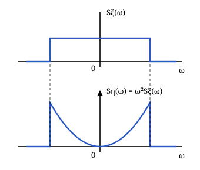
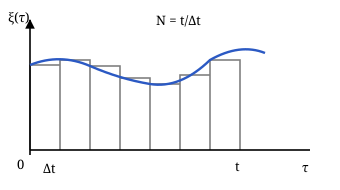
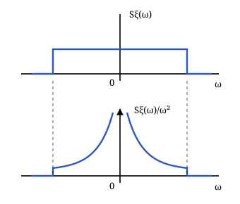
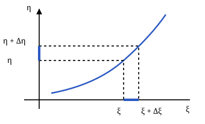
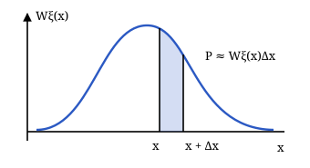
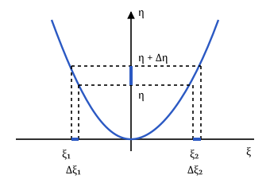

## Лекция 5. Характеристики преобразованных случайных процессов

Продолжение анализа линейной инерционной системы (ЛИС). На входе — случайный процесс $\xi(t)$, на выходе — $\eta(t)$; $h(t)$ — импульсная характеристика, $K(j\omega)$ — комплексная частотная характеристика системы. Начальные условия нулевые.

### Ковариационная и корреляционная функции выхода

В обозначениях курса $K_\xi$ — начальный момент второго порядка (ковариационная функция), $R_\xi$ — центральный (корреляционная функция).

Из интеграла Дюамеля:

$$
\eta(t)=\int_0^t\xi(t-u)h(u)\,du.
$$

Подставляем его в определение ковариационной функции:

$$
\begin{aligned}
&K_\eta(t_1,t_2)=M\{\eta(t_1)\eta(t_2)\}\\
&=M\left\{\int_0^{t_1}\xi(t_1-u)h(u)\,du\right.\\
&\qquad\left.\times\int_0^{t_2}\xi(t_2-v)h(v)\,dv\right\}\\
&=\int_0^{t_1}\!\int_0^{t_2}
M\{\xi(t_1-u)\xi(t_2-v)\}\\
&\qquad\times h(u)h(v)\,dv\,du\\
&=\int_0^{t_1}\!\int_0^{t_2}K_\xi(t_1-u,t_2-v)\\
&\qquad\times h(u)h(v)\,dv\,du.
\end{aligned}
$$

Если вход стационарен, положим $\tau=t_2-t_1$. Тогда

$$
\begin{aligned}
&K_\eta(t_1,t_2)\\
&=\int_0^{t_1}\!\int_0^{t_2}K_\xi(\tau+u-v)\\
&\qquad\times h(u)h(v)\,dv\,du.
\end{aligned}
$$

В переходном режиме выход ещё не стационарен: пределы интегрирования зависят от $t_1,t_2$. После затухания переходного процесса, при существовании установившегося режима, верхние пределы заменяются бесконечностью:

$$
\begin{aligned}
K_\eta(\tau)&=\int_0^\infty\!\int_0^\infty K_\xi(\tau+u-v)\\
&\quad\times h(u)h(v)\,dv\,du.
\end{aligned}
$$

Аналогично для корреляционной функции:

$$
\begin{aligned}
&R_\eta(t_1,t_2)\\
&=\int_0^{t_1}\!\int_0^{t_2}R_\xi(t_1-u,t_2-v)\\
&\qquad\times h(u)h(v)\,dv\,du,\\
&R_\eta(\tau)=\int_0^\infty\!\int_0^\infty R_\xi(\tau+u-v)\\
&\qquad\times h(u)h(v)\,dv\,du.
\end{aligned}
$$

Дисперсия стационарного выхода $D_\eta=R_\eta(0)$. Для нестационарного процесса берём совпадающие моменты времени:

$$
D_\eta(t)=R_\eta(t,t).
$$

### Спектральная плотность мощности выхода

Рассмотрим стационарный центрированный вход и установившийся режим. Преобразуем ковариационную функцию по Фурье:

$$
\begin{aligned}
&S_\eta(\omega)=\int_{-\infty}^\infty K_\eta(\tau)e^{-j\omega\tau}\,d\tau\\
&=\int_{-\infty}^\infty\!\int_0^\infty\!\int_0^\infty
K_\xi(\tau+u-v)\\
&\qquad\times h(u)h(v)e^{-j\omega\tau}\,dv\,du\,d\tau.
\end{aligned}
$$

Замена $z=\tau+u-v$, $\tau=z-u+v$ позволяет разделить интегралы:

$$
\begin{aligned}
&S_\eta(\omega)=\int_{-\infty}^\infty K_\xi(z)e^{-j\omega z}\,dz\\
&\quad\times\int_0^\infty h(u)e^{j\omega u}\,du\\
&\quad\times\int_0^\infty h(v)e^{-j\omega v}\,dv\\
&=S_\xi(\omega)K(-j\omega)K(j\omega).
\end{aligned}
$$

Для действительной импульсной характеристики $K(-j\omega)=K^*(j\omega)$, поэтому

$$
\boxed{S_\eta(\omega)=S_\xi(\omega)|K(j\omega)|^2.}
$$

Дисперсия центрированного стационарного выхода:

$$
D_\eta=\frac1{2\pi}\int_{-\infty}^\infty S_\eta(\omega)\,d\omega.
$$

### Взаимные характеристики входа и выхода

Начальная взаимная моментная функция:

$$
\begin{aligned}
&K_{\xi\eta}(t_1,t_2)=M\{\xi(t_1)\eta(t_2)\}\\
&=\int_0^{t_2}M\{\xi(t_1)\xi(t_2-u)\}h(u)\,du\\
&=\int_0^{t_2}K_\xi(t_1,t_2-u)h(u)\,du.
\end{aligned}
$$

Для стационарного входа аргумент $K_\xi$ равен $\tau-u$. В установившемся режиме

$$
K_{\xi\eta}(\tau)=\int_0^\infty K_\xi(\tau-u)h(u)\,du.
$$

Для центрированных процессов это также взаимная корреляционная функция. Взаимная спектральная плотность находится заменой $z=\tau-u$:

$$
\begin{aligned}
&S_{\xi\eta}(\omega)\\
&=\int_{-\infty}^\infty\!\int_0^\infty
K_\xi(\tau-u)h(u)e^{-j\omega\tau}\,du\,d\tau\\
&=\int_{-\infty}^\infty K_\xi(z)e^{-j\omega z}\,dz\\
&\quad\times\int_0^\infty h(u)e^{-j\omega u}\,du\\
&=S_\xi(\omega)K(j\omega).
\end{aligned}
$$

Квадрат частотной когерентности:

$$
\begin{aligned}
\gamma^2(\omega)&=\frac{|S_{\xi\eta}(\omega)|^2}
{S_\xi(\omega)S_\eta(\omega)}\\
&=\frac{S_\xi^2(\omega)|K(j\omega)|^2}
{S_\xi^2(\omega)|K(j\omega)|^2}=1.
\end{aligned}
$$

Результат справедлив там, где знаменатель ненулевой: вход и выход связаны линейным преобразованием.

### Дифференцирование случайного процесса

Случайная функция $\eta(t)$ называется **производной** $\xi(t)$ в среднеквадратическом смысле, если

$$
\lim_{\Delta t\to0}M\left\{
\left[\eta(t)-\frac{\xi(t+\Delta t)-\xi(t)}{\Delta t}\right]^2
\right\}=0.
$$

Обозначение: $\eta(t)=d\xi(t)/dt$.

Среднее производной равно производной среднего:

$$
\begin{aligned}
m_\eta(t)&=M\left\{\frac{d\xi(t)}{dt}\right\}\\
&=\frac{d}{dt}M\{\xi(t)\}=\frac{dm_\xi(t)}{dt}.
\end{aligned}
$$

Для стационарного входа $m_\xi=\mathrm{const}$, поэтому $m_\eta=0$. При существовании среднеквадратической производной выход также стационарен.

Ковариационная функция производной:

$$
\begin{aligned}
K_\eta(t_1,t_2)
&=M\left\{\frac{d\xi(t_1)}{dt_1}\frac{d\xi(t_2)}{dt_2}\right\}\\
&=\frac{\partial^2}{\partial t_1\partial t_2}
M\{\xi(t_1)\xi(t_2)\}\\
&=\frac{\partial^2 K_\xi(t_1,t_2)}{\partial t_1\partial t_2}.
\end{aligned}
$$

Для стационарного входа $\tau=t_2-t_1$, поэтому дифференцирование по $t_1$ вносит минус, а по $t_2$ — плюс:

$$
K_\eta(\tau)=-\frac{d^2K_\xi(\tau)}{d\tau^2}.
$$

> Для дифференцируемости в среднеквадратическом смысле важна вторая производная корреляционной функции в нуле. Все приведённые операции предполагают существование соответствующих производных и моментов.

### Спектр и дисперсия производной

Для идеального дифференциатора $K(j\omega)=j\omega$, следовательно,

$$
\begin{aligned}
S_\eta(\omega)&=S_\xi(\omega)|j\omega|^2\\
&=\omega^2S_\xi(\omega).
\end{aligned}
$$

Дисперсия производной:

$$
\begin{aligned}
D_\eta&=\frac1{2\pi}\int_{-\infty}^\infty S_\eta(\omega)\,d\omega\\
&=\frac1{2\pi}\int_{-\infty}^\infty\omega^2S_\xi(\omega)\,d\omega.
\end{aligned}
$$

Этот интеграл должен быть конечным. Для степенного хвоста $S_\xi(\omega)\sim C|\omega|^{-p}$ это требует $p>3$; убывания ровно как $|\omega|^{-3}$ недостаточно.

### Интегрирование случайного процесса

Случайная функция $\eta(t)$ называется **интегралом** $\xi(t)$ в среднеквадратическом смысле, если интегральные суммы сходятся к ней в среднем квадрате:

$$
\begin{aligned}
&\lim_{\Delta t\to0}M\left\{
\left[\eta(t)-\Delta t\sum_{k=1}^{N}\xi(k\Delta t)\right]^2
\right\}=0,\\
&N=t/\Delta t,\qquad
\eta(t)=\int_0^t\xi(\tau)\,d\tau.
\end{aligned}
$$

Математическое ожидание:

$$
\begin{aligned}
m_\eta(t)&=M\left\{\int_0^t\xi(\tau)\,d\tau\right\}\\
&=\int_0^t M\{\xi(\tau)\}\,d\tau\\
&=\int_0^t m_\xi(\tau)\,d\tau.
\end{aligned}
$$

Для стационарного входа $m_\eta(t)=m_\xi t$. При $m_\xi\ne0$ выход уже по среднему нестационарен. Нулевое среднее само по себе стационарности выхода не обеспечивает.

Ковариационная функция:

$$
\begin{aligned}
&K_\eta(t_1,t_2)=M\{\eta(t_1)\eta(t_2)\}\\
&=M\left\{\int_0^{t_1}\xi(u)\,du
\int_0^{t_2}\xi(v)\,dv\right\}\\
&=\int_0^{t_1}\!\int_0^{t_2}K_\xi(u,v)\,dv\,du.
\end{aligned}
$$

Для стационарного входа:

$$
\begin{aligned}
K_\eta(t_1,t_2)&=\int_0^{t_1}\!\int_0^{t_2}K_\xi(v-u)\,dv\,du,\\
R_\eta(t_1,t_2)&=\int_0^{t_1}\!\int_0^{t_2}R_\xi(v-u)\,dv\,du,\\
D_\eta(t)&=\int_0^t\!\int_0^t R_\xi(v-u)\,dv\,du.
\end{aligned}
$$

### Частотное описание интегрирования

Для идеального интегратора при $\omega\ne0$:

$$
\begin{aligned}
K(j\omega)&=\frac1{j\omega},\\
S_\eta(\omega)&=S_\xi(\omega)\left|\frac1{j\omega}\right|^2
=\frac{S_\xi(\omega)}{\omega^2}.
\end{aligned}
$$

> Это частотное соотношение применимо при существовании стационарного выхода. Интеграл от $0$ до $t$ в общем случае нестационарен, и приписывать ему стационарную СПМ по этой формуле нельзя. При ненулевом спектре входа около нуля деление на $\omega^2$ даёт расходящуюся площадь.

### Нелинейные неинерционные системы

В **нелинейной неинерционной системе (ННС)** выход зависит от входа в тот же момент времени:

$$
\eta(t)=\varphi[\xi(t)],
$$

где $\varphi$ — нелинейная функция. Нужно найти плотность вероятности выхода по плотности входа.

### Однозначная обратная функция

Пусть существует однозначная обратная функция $\xi=\Psi(\eta)$. Вероятность малого интервала приблизительно равна плотности, умноженной на его ширину:

$$
P\{x<\xi<x+\Delta x\}\approx W_\xi(x)\Delta x.
$$

Соответствующие интервалы входа и выхода имеют одинаковую вероятность:

$$
W_\eta(\eta)|d\eta|=W_\xi(\xi)|d\xi|.
$$

Поэтому

$$
\begin{aligned}
W_\eta(\eta)&=W_\xi(\xi)\left|\frac{d\xi}{d\eta}\right|\\
&=W_\xi[\Psi(\eta)]\left|\frac{d\Psi(\eta)}{d\eta}\right|.
\end{aligned}
$$

Модуль производной учитывает ширину интервала независимо от направления изменения функции. Аргумент времени в плотностях здесь опущен: преобразование выполняется для каждого фиксированного $t$.

### Несколько ветвей обратной функции

Если одному значению $\eta$ соответствуют два значения входа $\xi_1=\Psi_1(\eta)$ и $\xi_2=\Psi_2(\eta)$, вероятности обеих ветвей складываются. Ширины входных интервалов могут различаться.

$$
\begin{aligned}
&W_\eta(\eta)|d\eta|\\
&=W_\xi(\xi_1)|d\xi_1|+W_\xi(\xi_2)|d\xi_2|,\\
&W_\eta(\eta)=W_\xi[\Psi_1(\eta)]
\left|\frac{d\Psi_1(\eta)}{d\eta}\right|\\
&\qquad+W_\xi[\Psi_2(\eta)]
\left|\frac{d\Psi_2(\eta)}{d\eta}\right|.
\end{aligned}
$$

Для $k$ ветвей $\xi_i=\Psi_i(\eta)$, $i=1,\ldots,k$:

$$
\begin{aligned}
W_\eta(\eta)&=\sum_{i=1}^k W_\xi(\xi_i)
\left|\frac{d\xi_i}{d\eta}\right|\\
&=\sum_{i=1}^k W_\xi[\Psi_i(\eta)]
\left|\frac{d\Psi_i(\eta)}{d\eta}\right|.
\end{aligned}
$$

Суммируются все допустимые ветви на области значений входа, где применима замена переменной.
