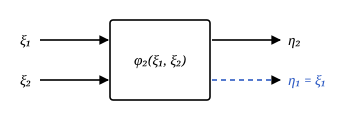
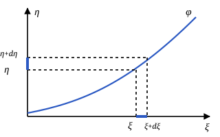
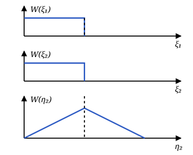
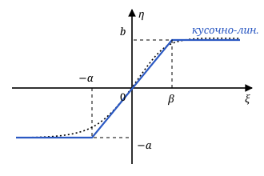
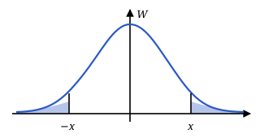
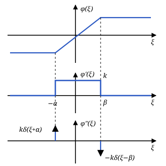

## Лекция 6. Нелинейные неинерционные преобразования случайных процессов

*Лекция 23.10.26.* Продолжение лекции 5: на вход нелинейной неинерционной системы (ННС) поступает несколько случайных величин, нужно найти распределение и моментные функции выхода.

### Многомерное нелинейное преобразование

Пусть ННС имеет $n$ входов и $n$ выходов:

$$
\begin{cases}
\eta_1=\varphi_1(\xi_1,\xi_2,\ldots,\xi_n),\\
\eta_2=\varphi_2(\xi_1,\xi_2,\ldots,\xi_n),\\
\quad\vdots\\
\eta_n=\varphi_n(\xi_1,\xi_2,\ldots,\xi_n).
\end{cases}
$$

На входе задана $n$-мерная плотность вероятности $W_n(\xi_1,\ldots,\xi_n)$. Нужно найти плотность на выходе $W_n(\eta_1,\eta_2,\ldots,\eta_n)$.

**Обратная характеристика** — выражение входов через выходы:

$$
\begin{cases}
\xi_1=\Psi_1(\eta_1,\eta_2,\ldots,\eta_n),\\
\xi_2=\Psi_2(\eta_1,\eta_2,\ldots,\eta_n),\\
\quad\vdots\\
\xi_n=\Psi_n(\eta_1,\eta_2,\ldots,\eta_n).
\end{cases}
$$

Плотность на выходе равна плотности на входе, умноженной на модуль якобиана преобразования:

$$
\begin{aligned}
&W_n(\eta_1,\eta_2,\ldots,\eta_n)=\\
&=W_n(\xi_1,\xi_2,\ldots,\xi_n)\,|D|=\\
&=W_n(\Psi_1,\Psi_2,\ldots,\Psi_n)\,|D|,
\end{aligned}
$$

где $\Psi_i=\Psi_i(\eta_1,\eta_2,\ldots,\eta_n)$, а $D$ — **якобиан преобразования**, определитель матрицы $n\times n$:

$$
D=\begin{vmatrix}
\dfrac{\partial\Psi_1}{\partial\eta_1} & \dfrac{\partial\Psi_2}{\partial\eta_1} & \cdots & \dfrac{\partial\Psi_n}{\partial\eta_1}\\[2ex]
\dfrac{\partial\Psi_1}{\partial\eta_2} & \dfrac{\partial\Psi_2}{\partial\eta_2} & \cdots & \dfrac{\partial\Psi_n}{\partial\eta_2}\\[2ex]
\vdots & \vdots & \ddots & \vdots\\[1ex]
\dfrac{\partial\Psi_1}{\partial\eta_n} & \dfrac{\partial\Psi_2}{\partial\eta_n} & \cdots & \dfrac{\partial\Psi_n}{\partial\eta_n}
\end{vmatrix}.
$$

### Пример: два входа и два выхода

Пусть интересует только одна функция двух входов $\eta_2=\varphi_2(\xi_1,\xi_2)$. Второй выход вводим вспомогательно, $\eta_1=\xi_1$:

$$
\begin{cases}
\eta_2=\varphi_2(\xi_1,\xi_2),\\
\eta_1=\xi_1.
\end{cases}
$$

Задано $W_2(\xi_1,\xi_2)$, нужно найти $W(\eta_2)$. Обратная характеристика:

$$
\begin{cases}
\xi_1=\Psi_1(\eta_1,\eta_2)=\eta_1,\\
\xi_2=\Psi_2(\eta_1,\eta_2).
\end{cases}
$$

Якобиан:

$$
D=\begin{vmatrix}
1 & \dfrac{\partial\Psi_2}{\partial\eta_1}\\[2ex]
0 & \dfrac{\partial\Psi_2}{\partial\eta_2}
\end{vmatrix}
=\frac{\partial\Psi_2}{\partial\eta_2}.
$$

Двумерная плотность выхода:

$$
\begin{aligned}
&W_2(\eta_1,\eta_2)=W_2(\xi_1,\xi_2)\,|D|=\\
&=W_2(\xi_1,\xi_2)\left|\frac{\partial\Psi_2}{\partial\eta_2}\right|=\\
&=W_2\bigl(\eta_1,\Psi_2(\eta_1,\eta_2)\bigr)
\left|\frac{\partial\Psi_2}{\partial\eta_2}\right|.
\end{aligned}
$$

Плотность нужного выхода получается интегрированием по вспомогательной переменной:

$$
W(\eta_2)=\int_{-\infty}^{\infty}W_2(\eta_1,\eta_2)\,d\eta_1.
$$

> Это обобщение одномерного случая из лекции 5: вероятности соответствующих малых интервалов совпадают, $W(\eta)\,d\eta=W(\xi)\,d\xi$.

### Сумма, разность, произведение и частное

**1) Сумма.** $\eta_1=\xi_1$, $\eta_2=\xi_1+\xi_2$. Обратная характеристика:

$$
\begin{aligned}
\xi_1&=\eta_1,\\
\xi_2&=\eta_2-\xi_1=\eta_2-\eta_1=\Psi_2(\eta_1,\eta_2).
\end{aligned}
$$

Тогда $\dfrac{\partial\Psi_2}{\partial\eta_2}=1$ и

$$
\begin{aligned}
W_2(\eta_1,\eta_2)&=W_2(\xi_1,\xi_2)\cdot|1|=\\
&=W_2(\eta_1,\eta_2-\eta_1),\\
W(\eta_2)&=\int_{-\infty}^{\infty}W_2(\eta_1,\eta_2-\eta_1)\,d\eta_1.
\end{aligned}
$$

Если $\xi_1$ и $\xi_2$ независимы, $W_2(\xi_1,\xi_2)=W(\xi_1)W(\xi_2)$, и плотность суммы — свёртка плотностей слагаемых:

$$
W(\eta_2)=\int_{-\infty}^{\infty}
\underbrace{W(\eta_1)}_{W_{\xi_1}}\,
\underbrace{W(\eta_2-\eta_1)}_{W_{\xi_2}}\,d\eta_1.
$$

**2) Разность.** $\eta_1=\xi_1$, $\eta_2=\xi_1-\xi_2$:

$$
\begin{aligned}
\xi_1&=\eta_1,\\
\xi_2&=\xi_1-\eta_2=\eta_1-\eta_2=\Psi_2,\\
\frac{\partial\Psi_2}{\partial\eta_2}&=-1,
\end{aligned}
$$

$$
\begin{aligned}
W(\eta_2)&=\int_{-\infty}^{\infty}W_2(\eta_1,\eta_1-\eta_2)\,|-1|\,d\eta_1=\\
&=\int_{-\infty}^{\infty}W_2(\eta_1,\eta_1-\eta_2)\,d\eta_1.
\end{aligned}
$$

**3) Произведение.** $\eta_1=\xi_1$, $\eta_2=\xi_1\xi_2$:

$$
\begin{aligned}
\xi_1&=\eta_1,\\
\xi_2&=\frac{\eta_2}{\xi_1}=\frac{\eta_2}{\eta_1}=\Psi_2,\qquad
\frac{\partial\Psi_2}{\partial\eta_2}=\frac1{\eta_1},
\end{aligned}
$$

$$
W(\eta_2)=\int_{-\infty}^{\infty}
W_2\left(\eta_1,\frac{\eta_2}{\eta_1}\right)
\left|\frac1{\eta_1}\right|d\eta_1.
$$

**4) Частное.** $\eta_1=\xi_1$, $\eta_2=\xi_1/\xi_2$:

$$
\begin{aligned}
\xi_1&=\eta_1,\\
\xi_2&=\frac{\xi_1}{\eta_2}=\frac{\eta_1}{\eta_2}=\Psi_2,\qquad
\frac{\partial\Psi_2}{\partial\eta_2}=-\frac{\eta_1}{\eta_2^2},
\end{aligned}
$$

$$
W(\eta_2)=\int_{-\infty}^{\infty}
W_2\left(\eta_1,\frac{\eta_1}{\eta_2}\right)
\left|\frac{\eta_1}{\eta_2^2}\right|d\eta_1.
$$

### Моментные функции на выходе ННС

Для ННС $\eta(t)=\varphi(\xi(t))$ среднее на выходе:

$$
\begin{aligned}
m_\eta(t)&=M\{\eta(t)\}=M\{\varphi(\xi(t))\}=\\
&=\int_{-\infty}^{\infty}\varphi(\xi)\,W(\xi;t)\,d\xi.
\end{aligned}
$$

Ковариационная функция выхода:

$$
\begin{aligned}
&K_\eta(t_1,t_2)=M\{\eta(t_1)\eta(t_2)\}=\\
&=M\{\varphi(\xi(t_1))\,\varphi(\xi(t_2))\}=\\
&=\iint_{-\infty}^{\infty}\varphi(\xi_1)\varphi(\xi_2)\times\\
&\qquad\times W_2(\xi_1,\xi_2;t_1,t_2)\,d\xi_1\,d\xi_2.
\end{aligned}
$$

Для стационарного выхода СПМ находится по ковариационной функции:

$$
S_\eta(\omega)=\int_{-\infty}^{\infty}K_\eta(\tau)\,e^{-j\omega\tau}\,d\tau.
$$

Чтобы вычислить эти интегралы, характеристику $\varphi(\xi(t))$ аппроксимируют. Рассматриваются два способа:

1. полиномиальная аппроксимация;
2. кусочно-линейная аппроксимация.

### Полиномиальная аппроксимация

Пусть $\varphi(\xi)$ — аналитическая функция в окрестности точки $\xi=0$. Тогда

$$
\begin{aligned}
&\varphi[\xi(t)]=a_0+a_1\xi(t)+a_2\xi^2(t)+\ldots\\
&\qquad+a_n\xi^n(t),\\
&a_k=\frac1{k!}\left.\frac{d^k\varphi(\xi)}{d\xi^k}\right|_{\xi=0}.
\end{aligned}
$$

Среднее выражается через начальные моменты входа $M_{k\xi}(t)=M\{\xi^k(t)\}$:

$$
\begin{aligned}
&m_\eta(t)=M\{\eta(t)\}=\\
&=M\{a_0+a_1\xi(t)+a_2\xi^2(t)+\ldots+a_n\xi^n(t)\}=\\
&=a_0+a_1M\{\xi(t)\}+a_2M\{\xi^2(t)\}+\ldots\\
&\qquad+a_nM\{\xi^n(t)\}=\\
&=a_0+a_1M_{1\xi}(t)+a_2M_{2\xi}(t)+\ldots\\
&\qquad+a_nM_{n\xi}(t).
\end{aligned}
$$

Ковариационная функция:

$$
\begin{aligned}
&K_\eta(t_1,t_2)=M\{\eta(t_1)\eta(t_2)\}=\\
&=M\bigl\{[a_0+a_1\xi(t_1)+\ldots+a_n\xi^n(t_1)]\times\\
&\qquad\times[a_0+a_1\xi(t_2)+\ldots+a_n\xi^n(t_2)]\bigr\}=\\
&=a_0^2+\underbrace{a_0a_1M_{1\xi}(t_1)+\ldots+a_0a_nM_{n\xi}(t_1)}_{n\text{ слагаемых}}+\\
&\quad+\underbrace{a_0a_1M_{1\xi}(t_2)+\ldots+a_0a_nM_{n\xi}(t_2)}_{n\text{ слагаемых}}+\\
&\quad+\underbrace{\sum_{i=1}^{n}\sum_{j=1}^{n}a_ia_jM_{ij\xi}(t_1,t_2)}_{n^2\text{ слагаемых}}.
\end{aligned}
$$

Короче то же самое записывается одной двойной суммой из $(n+1)^2$ слагаемых:

$$
\begin{aligned}
&K_\eta(t_1,t_2)=\sum_{i=0}^{n}\sum_{j=0}^{n}a_ia_j\,M_{ij\xi}(t_1,t_2),\\
&M_{ij\xi}(t_1,t_2)=M\{\xi^i(t_1)\,\xi^j(t_2)\},
\end{aligned}
$$

где $M_{00\xi}=1$, $M_{i0\xi}(t_1,t_2)=M_{i\xi}(t_1)$, $M_{0j\xi}(t_1,t_2)=M_{j\xi}(t_2)$. Значит, для ковариации выхода нужны одномерные моменты входа до порядка $n$ и двумерные $M_{ij\xi}(t_1,t_2)$ при $i,j=1,\ldots,n$. При $t_1=t_2=t$ двумерные моменты переходят в одномерные: $M_{ij\xi}(t,t)=M_{(i+j)\xi}(t)$ — от $M_2$ до $M_{2n}$.

Для гауссовского входа эти моменты высших порядков выражаются через моменты второго порядка по теореме Иссерлиса.

### Теорема Иссерлиса

**Теорема Иссерлиса** (в физике — теорема Вика): если $x_1,\ldots,x_{2m}$ — центрированные совместно гауссовские случайные величины, то среднее их произведения равно сумме по всем разбиениям индексов на пары произведений попарных моментов:

$$
M\{x_1x_2\cdots x_{2m}\}=\sum_{\text{разбиения на пары}}\ \prod_{(i,j)}M\{x_ix_j\}.
$$

Число разбиений на пары равно $1\cdot3\cdot5\cdots(2m-1)$. Момент нечётного порядка равен нулю: разбить нечётное число сомножителей на пары нельзя. Величины могут повторяться.

Для четырёх сомножителей — три разбиения:

$$
\begin{aligned}
&M\{x_1x_2x_3x_4\}=M\{x_1x_2\}M\{x_3x_4\}+\\
&\quad+M\{x_1x_3\}M\{x_2x_4\}+M\{x_1x_4\}M\{x_2x_3\}.
\end{aligned}
$$

Следствия для центрированного ГСП с дисперсией $\sigma^2$ и корреляционной функцией $R_\xi(\tau)=\sigma^2r_\xi(\tau)$:

- при $x_1=\ldots=x_k=\xi(t)$ каждое разбиение даёт $\sigma^k$, поэтому $\mu_k=1\cdot3\cdots(k-1)\,\sigma^k$ для чётного $k$ и $\mu_k=0$ для нечётного;
- при $x_1=x_2=\xi(t_1)$, $x_3=x_4=\xi(t_2)$:
  $$
  \begin{aligned}
  \mu_{22}(\tau)&=\sigma^2\cdot\sigma^2+2R_\xi^2(\tau)=\\
  &=\sigma^4\bigl(1+2r_\xi^2(\tau)\bigr).
  \end{aligned}
  $$

Ниже те же результаты получены другим путём — через разложение двумерной плотности.

### Частный случай: стационарный центрированный ГСП

Пусть $\xi(t)$ — стационарный центрированный ГСП с плотностью

$$
W(\xi)=\frac1{\sqrt{2\pi}\,\sigma}\,e^{-\frac{\xi^2}{2\sigma^2}}.
$$

Центральные моменты:

$$
\mu_k=\begin{cases}
1\cdot3\cdot5\cdots(k-1)\,\sigma^k, & k\text{ — чётное},\\
0, & k\text{ — нечётное}.
\end{cases}
$$

Например,

$$
\begin{aligned}
\mu_4&=\int_{-\infty}^{\infty}\xi^4\,
\frac1{\sqrt{2\pi}\,\sigma}\,e^{-\frac{\xi^2}{2\sigma^2}}\,d\xi=3\sigma^4,\\
\mu_6&=1\cdot3\cdot5\,\sigma^6=15\sigma^6,\\
\mu_7&=0.
\end{aligned}
$$

#### Двумерные моментные функции

Нужно найти $\mu_{ij}(t_1,t_2)$. Для двумерной плотности стационарного центрированного ГСП используется разложение из лекции 4:

$$
\begin{aligned}
&W_2(\xi_1,\xi_2;\tau)=\sum_{k=0}^{\infty}\sigma^{-2}\,
\Phi^{(k+1)}\left(\frac{\xi_1}{\sigma}\right)\times\\
&\qquad\times\Phi^{(k+1)}\left(\frac{\xi_2}{\sigma}\right)
\frac{r_\xi^k(\tau)}{k!},
\end{aligned}
$$

где $r_\xi(\tau)$ — нормированная корреляционная функция,

$$
\Phi(x)=\frac1{\sqrt{2\pi}}\int_{-\infty}^{x}e^{-\frac{z^2}{2}}\,dz.
$$

Тогда

$$
\begin{aligned}
&\mu_{ij}(t_1,t_2)=M\{\xi^i(t_1)\,\xi^j(t_2)\}=\\
&=\iint_{-\infty}^{\infty}\xi_1^i\xi_2^j\,
W_2(\xi_1,\xi_2;\tau)\,d\xi_1\,d\xi_2=\\
&=\iint_{-\infty}^{\infty}\xi_1^i\xi_2^j
\sum_{k=0}^{\infty}\sigma^{-2}\,
\Phi^{(k+1)}\left(\frac{\xi_1}{\sigma}\right)\times\\
&\qquad\times\Phi^{(k+1)}\left(\frac{\xi_2}{\sigma}\right)
\frac{r_\xi^k(\tau)}{k!}\,d\xi_1\,d\xi_2.
\end{aligned}
$$

Замена переменных:

$$
\begin{aligned}
z_1&=\frac{\xi_1}{\sigma},\quad \xi_1=z_1\sigma,\quad d\xi_1=\sigma\,dz_1,\\
z_2&=\frac{\xi_2}{\sigma},\quad \xi_2=z_2\sigma,\quad d\xi_2=\sigma\,dz_2.
\end{aligned}
$$

$$
\begin{aligned}
&\mu_{ij}=\iint_{-\infty}^{\infty}(z_1\sigma)^i(z_2\sigma)^j
\sum_{k=0}^{\infty}\sigma^{-2}\,\Phi^{(k+1)}(z_1)\times\\
&\qquad\times\Phi^{(k+1)}(z_2)\,\frac{r_\xi^k(\tau)}{k!}\,
\sigma\,dz_1\,\sigma\,dz_2=\\
&=\sigma^{i+j}\sum_{k=0}^{\infty}\frac{r_\xi^k(\tau)}{k!}
\underbrace{\int_{-\infty}^{\infty}z_1^i\,\Phi^{(k+1)}(z_1)\,dz_1}_{N_{ik}}\times\\
&\qquad\times\underbrace{\int_{-\infty}^{\infty}z_2^j\,\Phi^{(k+1)}(z_2)\,dz_2}_{N_{jk}}.
\end{aligned}
$$

Итог:

$$
\boxed{\mu_{ij}(\tau)=\sigma^{i+j}\sum_{k=0}^{\infty}
\frac{r_\xi^k(\tau)}{k!}\,N_{ik}N_{jk}}
$$

Свойства коэффициентов $N_{ik}$:

1. $N_{ik}=0$, если $i<k$;
2. $N_{ik}=0$, если $i$ и $k$ имеют разную чётность;
3. по модулю
   $$
   |N_{ik}|=\underbrace{i(i-1)(i-2)\cdots}_{k\text{ множителей}}\cdot
   \underbrace{1\cdot3\cdot5\cdots}_{\text{до }(i-k+1)}
   $$
   — нечётные числа берутся до $(i-k+1)$, **не включая** его;
4. знак $N_{ik}$ — «$+$», если $i$ и $k$ чётные, и «$-$», если $i$ и $k$ нечётные.

**Пример.** Найти $\mu_{22}(\tau)$:

$$
\mu_{22}(\tau)=\sigma^4\sum_{k=0}^{\infty}\frac{r_\xi^k(\tau)}{k!}\,N_{2k}N_{2k}.
$$

- $k=0$: $N_{20}=1$ (нечётные множители до $i-k+1=2-0+1=3$, не включая);
- $k=1$: $N_{21}=0$ (разная чётность);
- $k=2$: $N_{22}=2\cdot(2-1)\cdot1=2$;
- $k=3$: $N_{23}=0$;
- $k=4$: $N_{24}=0$, так как $2<4$.

$$
\begin{aligned}
\mu_{22}(\tau)&=\sigma^4\left[1\cdot1+\frac{r_\xi^2(\tau)}{2}\cdot2\cdot2\right]=\\
&=\sigma^4\bigl(1+2r_\xi^2(\tau)\bigr).
\end{aligned}
$$

### Кусочно-линейная аппроксимация

Гладкую характеристику с насыщением заменяют тремя отрезками прямых:

$$
\eta=\begin{cases}
k\xi, & -\alpha\le\xi\le\beta,\\
-a, & \xi<-\alpha,\\
b, & \xi\ge\beta.
\end{cases}
$$

#### Среднее на выходе

$$
\begin{aligned}
&m_\eta(t)=M\{\eta(t)\}=
\int_{-\infty}^{\infty}\varphi(\xi(t))\,W(\xi;t)\,d\xi=\\
&=\int_{-\infty}^{-\alpha}(-a)\,W(\xi;t)\,d\xi
+\int_{-\alpha}^{\beta}k\xi\,W(\xi;t)\,d\xi+\\
&\qquad+\int_{\beta}^{+\infty}b\,W(\xi;t)\,d\xi.
\end{aligned}
$$

Пусть $\xi(t)$ — центрированный ГСП:

$$
\begin{aligned}
&m_\eta(t)=
\underbrace{\int_{-\infty}^{-\alpha}(-a)\frac1{\sqrt{2\pi}\,\sigma}
e^{-\frac{\xi^2}{2\sigma^2}}d\xi}_{\text{I}}+\\
&+\underbrace{\int_{-\alpha}^{\beta}k\xi\frac1{\sqrt{2\pi}\,\sigma}
e^{-\frac{\xi^2}{2\sigma^2}}d\xi}_{\text{II}}+\\
&+\underbrace{\int_{\beta}^{+\infty}b\frac1{\sqrt{2\pi}\,\sigma}
e^{-\frac{\xi^2}{2\sigma^2}}d\xi}_{\text{III}}.
\end{aligned}
$$

**Слагаемое I.** Замена $t=\xi/\sigma$, $\xi=t\sigma$, $d\xi=\sigma\,dt$:

$$
\begin{aligned}
\text{I}&=-a\int_{-\infty}^{-\alpha}\frac1{\sqrt{2\pi}\,\sigma}
e^{-\frac{\xi^2}{2\sigma^2}}d\xi=\\
&=-a\int_{-\infty}^{-\alpha/\sigma}\frac1{\sqrt{2\pi}}
e^{-\frac{t^2}{2}}dt
=-a\,\Phi\left(-\frac{\alpha}{\sigma}\right),
\end{aligned}
$$

где $\Phi$ — интеграл вероятности. По симметрии гауссовской плотности

$$
\Phi(-x)=1-\Phi(x).
$$

$$
\text{I}=-a\left(1-\Phi\left(\frac{\alpha}{\sigma}\right)\right)
=a\left(\Phi\left(\frac{\alpha}{\sigma}\right)-1\right).
$$

**Слагаемое III.** С той же заменой:

$$
\begin{aligned}
\text{III}&=b\int_{\beta}^{\infty}\frac1{\sqrt{2\pi}\,\sigma}
e^{-\frac{\xi^2}{2\sigma^2}}d\xi=\\
&=b\int_{\beta/\sigma}^{\infty}\frac1{\sqrt{2\pi}}
e^{-\frac{t^2}{2}}dt
=b\left(1-\Phi\left(\frac{\beta}{\sigma}\right)\right).
\end{aligned}
$$

**Слагаемое II.** Используем $\xi\,d\xi=d\left(\xi^2/2\right)$:

$$
\begin{aligned}
\text{II}&=\frac{k}{\sqrt{2\pi}\,\sigma}\int_{-\alpha}^{\beta}
\xi\,e^{-\frac{\xi^2}{2\sigma^2}}d\xi=\\
&=\frac{k\sigma^2}{\sqrt{2\pi}\,\sigma}\int_{-\alpha}^{\beta}
e^{-\frac{\xi^2}{2\sigma^2}}\,d\frac{\xi^2}{2\sigma^2}=\\
&=-\frac{k\sigma}{\sqrt{2\pi}}
\left.e^{-\frac{\xi^2}{2\sigma^2}}\right|_{-\alpha}^{\beta}=\\
&=\frac{k\sigma}{\sqrt{2\pi}}
\left(e^{-\frac{\alpha^2}{2\sigma^2}}-e^{-\frac{\beta^2}{2\sigma^2}}\right).
\end{aligned}
$$

Итог:

$$
\begin{aligned}
m_\eta(t)&=a\left[\Phi\left(\frac{\alpha}{\sigma}\right)-1\right]+\\
&+\frac{k\sigma}{\sqrt{2\pi}}
\left(e^{-\frac{\alpha^2}{2\sigma^2}}-e^{-\frac{\beta^2}{2\sigma^2}}\right)+\\
&+b\left[1-\Phi\left(\frac{\beta}{\sigma}\right)\right].
\end{aligned}
$$

#### Ковариационная функция на выходе

$$
\begin{aligned}
&K_\eta(t_1,t_2)=M\{\eta(t_1)\eta(t_2)\}=\\
&=M\{\varphi[\xi(t_1)]\,\varphi[\xi(t_2)]\}=\\
&=\iint_{-\infty}^{\infty}\varphi(\xi_1)\varphi(\xi_2)\times\\
&\qquad\times W_2(\xi_1,\xi_2;t_1,t_2)\,d\xi_1\,d\xi_2.
\end{aligned}
$$

Область интегрирования разбивается на $3\times3$ части по участкам характеристики:

$$
\begin{aligned}
&K_\eta=\int_{-\infty}^{-\alpha}\!\int_{-\infty}^{-\alpha}
(-a)(-a)\,W_2(\ldots)\,d\xi_1\,d\xi_2+\\
&+\int_{-\infty}^{-\alpha}\!\int_{-\alpha}^{\beta}
(-a)\,k\xi_2\,W_2(\ldots)\,d\xi_1\,d\xi_2+\\
&+\int_{-\infty}^{-\alpha}\!\int_{\beta}^{\infty}
(-a)\,b\,W_2(\ldots)\,d\xi_1\,d\xi_2+\\
&+\int_{-\alpha}^{\beta}\!\int_{-\infty}^{-\alpha}
k\xi_1(-a)\,W_2(\ldots)\,d\xi_1\,d\xi_2+\\
&+\int_{-\alpha}^{\beta}\!\int_{-\alpha}^{\beta}\ldots
\;+\;\text{ещё 4 слагаемых}.
\end{aligned}
$$

#### Метод дельта-функций

Пусть $\xi(t)$ — стационарный центрированный ГСП. Подставим разложение двумерной плотности:

$$
\begin{aligned}
&K_\eta(\tau)=\iint_{-\infty}^{\infty}
\varphi(\xi_1)\varphi(\xi_2)\,\sigma^{-2}
\sum_{k=0}^{\infty}\frac{r_\xi^k(\tau)}{k!}\times\\
&\qquad\times\Phi^{(k+1)}\left(\frac{\xi_1}{\sigma}\right)
\Phi^{(k+1)}\left(\frac{\xi_2}{\sigma}\right)d\xi_1\,d\xi_2.
\end{aligned}
$$

Слагаемое с $k=0$ даёт квадрат среднего:

$$
\begin{aligned}
&\iint_{-\infty}^{\infty}\varphi(\xi_1)\varphi(\xi_2)\,
\sigma^{-2}\,\Phi'\left(\frac{\xi_1}{\sigma}\right)\times\\
&\qquad\times\Phi'\left(\frac{\xi_2}{\sigma}\right)d\xi_1\,d\xi_2
=m_\eta^2,
\end{aligned}
$$

а слагаемые с $k\ge1$ — корреляционную функцию выхода, $K_\eta(\tau)=m_\eta^2+R_\eta(\tau)$:

$$
\begin{aligned}
&R_\eta(\tau)=\sigma^{-2}\sum_{k=1}^{\infty}\frac{r_\xi^k(\tau)}{k!}
\underbrace{\int_{-\infty}^{\infty}\varphi(\xi_1)\,
\Phi^{(k+1)}\left(\frac{\xi_1}{\sigma}\right)d\xi_1}_{I_k}\times\\
&\qquad\times\underbrace{\int_{-\infty}^{\infty}\varphi(\xi_2)\,
\Phi^{(k+1)}\left(\frac{\xi_2}{\sigma}\right)d\xi_2}_{I_k}.
\end{aligned}
$$

Интеграл $I_k$ берётся по частям, $\int u\,dv=uv-\int v\,du$:

$$
\begin{aligned}
u&=\varphi(\xi), & du&=\varphi^{(1)}(\xi)\,d\xi,\\
dv&=\Phi^{(k+1)}\left(\frac{\xi}{\sigma}\right)d\xi, &
v&=\sigma\,\Phi^{(k)}\left(\frac{\xi}{\sigma}\right).
\end{aligned}
$$

$$
\begin{aligned}
&I_k=\int_{-\infty}^{\infty}\varphi(\xi)\,
\Phi^{(k+1)}\left(\frac{\xi}{\sigma}\right)d\xi=\\
&=\underbrace{\left.\varphi(\xi)\,\sigma\,\Phi^{(k)}
\left(\frac{\xi}{\sigma}\right)\right|_{-\infty}^{\infty}}_{0}-\\
&-\sigma\int_{-\infty}^{\infty}\varphi^{(1)}(\xi)\,
\Phi^{(k)}\left(\frac{\xi}{\sigma}\right)d\xi=\\
&=\sigma^2\int_{-\infty}^{\infty}\varphi^{(2)}(\xi)\,
\Phi^{(k-1)}\left(\frac{\xi}{\sigma}\right)d\xi=\ldots=\\
&=(-1)^\nu\sigma^\nu\int_{-\infty}^{\infty}\varphi^{(\nu)}(\xi)\,
\Phi^{(k+1-\nu)}\left(\frac{\xi}{\sigma}\right)d\xi.
\end{aligned}
$$

Интегрирование по частям повторяют, пока производная $\varphi^{(\nu)}$ не станет набором дельта-функций. Для кусочно-линейной характеристики это происходит при $\nu=2$: $\varphi^{(1)}$ — прямоугольный импульс на участке $[-\alpha,\beta]$, а $\varphi^{(2)}$ — дельта-функции в точках излома.

Затем используется фильтрующее свойство дельта-функции:

$$
\int f(x)\,\delta(x-x_0)\,dx=f(x_0).
$$

> **Метод дельта-функций** для корреляционной функции: на входе обязательно стационарный центрированный ГСП.
