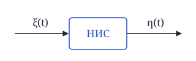
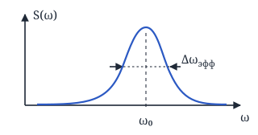
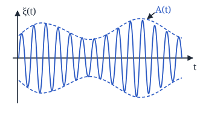
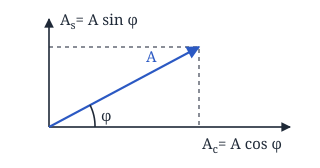
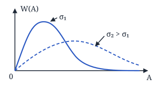
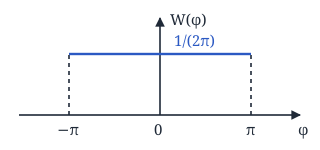
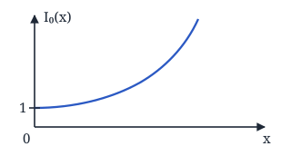
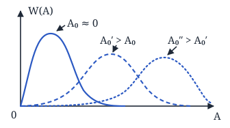

## Лекция 7. Нелинейные инерционные системы. Огибающая и фаза узкополосного процесса

## Преобразование случайных процессов в нелинейных инерционных системах

На вход нелинейной инерционной системы (НИС) поступает случайный процесс (СП) $\xi(t)$. Реакцию системы обозначим $\eta(t)$.

Общий вид нелинейного стохастического дифференциального уравнения

$$
\dot\eta(t)=g(\eta)+f(\xi,\eta,t),
$$

где $g$ и $f$ — заданные функции, хотя бы одна из которых нелинейна. Инерционность учитывается производной $\dot\eta(t)$.

Входное воздействие считают слабым, если $\sigma_\eta\ll\eta_0$, где $\eta_0$ — стационарное значение реакции, а $\sigma_\eta$ — её среднеквадратическое отклонение, $D_\eta=\sigma_\eta^2$.

- **Малое входное воздействие.** Применяют метод линеаризации.
- **Большое входное воздействие.** Сравнивают характерное время системы $T_{\text{сист}}$ с интервалом корреляции входного процесса $T_{\text{к}}$.
  - При $T_{\text{сист}}\gg T_{\text{к}}$ применяют аппарат марковских цепей и процессов.
  - При $T_{\text{сист}}\ll T_{\text{к}}$ применяют квазистатические методы. Пренебрегают производной и решают оставшееся нелинейное уравнение.
  - Случай $T_{\text{сист}}\approx T_{\text{к}}$ выделяют отдельно.

### Метод линеаризации

1. Записывают уравнение в операторном виде $L[\eta]=f(\xi)$.
2. Убирают производную из левой части и усредняют правую. Получают уравнение стационарности $L_0[\eta]=M\{f(\xi)\}$.
3. Решают уравнение стационарности и находят $\eta_0$.
4. Вычитают уравнение для $\eta_0$ из исходного.

   $$
   \begin{aligned}
   &L[\eta]-L_0[\eta_0]\\
   &\qquad =f(\xi)-M\{f(\xi)\}.
   \end{aligned}
   $$

5. Обозначают отклонение $\Delta\eta=\eta-\eta_0$. Левую часть раскладывают в ряд Тейлора в окрестности $\eta=\eta_0$ и отбрасывают члены с $\Delta\eta^k$ при $k>1$.
6. Решают полученное линейное уравнение для отклонения. В конспекте зависимость отклонения от входного процесса обозначена $\Delta\eta=\varphi(\xi)$.
7. Находят статистические характеристики $\Delta\eta$.
8. Восстанавливают $\eta=\Delta\eta+\eta_0$ и находят её статистические характеристики.
9. Проверяют условие $\sigma_\eta\ll\eta_0$.

## Огибающая и фаза стационарного узкополосного ГСП

Пусть $\xi(t)$ — стационарный узкополосный гауссовский случайный процесс (ГСП) с $m_\xi=0$ и дисперсией $D_\xi=\sigma^2$. Его одномерная плотность вероятности

$$
W(\xi)=\frac{1}{\sqrt{2\pi}\,\sigma}
e^{-\frac{\xi^2}{2\sigma^2}}.
$$

Эффективная ширина спектра $\Delta\omega_{\text{эфф}}\ll\omega_0$, где $\omega_0$ — центральная частота полосы.

$$
\xi(t)=A(t)\cos(\omega_0t-\varphi(t)),
$$

где $A(t)$ — огибающая, а $\varphi(t)$ — фаза. Обе меняются медленно по сравнению с несущим колебанием.

Чтобы найти $W(A)$ и $W(\varphi)$, разложим $\xi(t)$ по косинусной и синусной составляющим.

$$
\begin{aligned}
&\xi(t)=\underbrace{A(t)\cos\varphi(t)}_{A_c(t)}
            \cos(\omega_0t)\\
&\qquad +\underbrace{A(t)\sin\varphi(t)}_{A_s(t)}
            \sin(\omega_0t)\\
&=A_c(t)\cos(\omega_0t)+A_s(t)\sin(\omega_0t).
\end{aligned}
$$

Сначала находят $W(A_c)$ и $W(A_s)$, затем $W(A_c,A_s)$ и $W(A,\varphi)$. Из совместной плотности получают $W(A)$ и $W(\varphi)$.

### 1. Плотности квадратурных составляющих

При дифференцировании пренебрегаем производными медленно меняющихся квадратур $A_c(t)$ и $A_s(t)$. В дальнейших выкладках для них опускаем аргумент $t$.

$$
\begin{aligned}
&\xi(t)=A_c\cos(\omega_0t)+A_s\sin(\omega_0t),\\[3pt]
&\frac{\dot\xi(t)}{\omega_0}
 \approx -A_c\sin(\omega_0t)+A_s\cos(\omega_0t).
\end{aligned}
$$

Умножаем первое уравнение на $\cos(\omega_0t)$, второе на $-\sin(\omega_0t)$ и складываем. Слагаемые с $A_s$ сокращаются.

$$
\begin{aligned}
&\xi(t)\cos(\omega_0t)
 -\frac{\dot\xi(t)}{\omega_0}\sin(\omega_0t)\\
&\approx A_c\bigl(\cos^2(\omega_0t)+\sin^2(\omega_0t)\bigr)
 = A_c.
\end{aligned}
$$

Умножаем первое уравнение на $\sin(\omega_0t)$, второе на $\cos(\omega_0t)$ и складываем. Слагаемые с $A_c$ сокращаются.

$$
\begin{aligned}
&\xi(t)\sin(\omega_0t)
 +\frac{\dot\xi(t)}{\omega_0}\cos(\omega_0t)\\
&\approx A_s\bigl(\sin^2(\omega_0t)+\cos^2(\omega_0t)\bigr)
 = A_s.
\end{aligned}
$$

В этом приближении квадратуры представляются линейными комбинациями $\xi(t)$ и $\dot\xi(t)$, поэтому $A_c$ и $A_s$ совместно гауссовские. Их средние равны нулю, поскольку $m_\xi=0$ и $m_{\dot\xi}=dm_\xi/dt=0$.

$$
\begin{aligned}
&m_{A_c}=M\{A_c\}\\
&\approx M\{\xi(t)\}\cos(\omega_0t)\\
&\qquad -M\{\dot\xi(t)\}\frac{\sin(\omega_0t)}{\omega_0}=0,\\
&m_{A_s}=0.
\end{aligned}
$$

Для дисперсии косинусной квадратуры раскрываем квадрат.

$$
\begin{aligned}
&D_{A_c}=M\{A_c^2\}\\
&\approx \cos^2(\omega_0t)\,M\{\xi^2(t)\}\\
&\quad -\frac{2\sin(\omega_0t)\cos(\omega_0t)}{\omega_0}
             M\{\xi(t)\dot\xi(t)\}\\
&\quad +\frac{\sin^2(\omega_0t)}{\omega_0^2}
             M\{\dot\xi^2(t)\}.
\end{aligned}
$$

Смешанный момент равен нулю по стационарности.

$$
\begin{aligned}
&M\{\xi(t)\dot\xi(t)\}
 =\frac12\frac{d}{dt}M\{\xi^2(t)\}\\
&=\frac12\frac{dD_\xi}{dt}
 =\frac12\frac{d\sigma^2}{dt}=0.
\end{aligned}
$$

В приближении узкой полосы $D_{\dot\xi}=M\{\dot\xi^2(t)\}\approx\omega_0^2\sigma^2$. Тогда

$$
\begin{aligned}
D_{A_c}&\approx\sigma^2\bigl(\cos^2(\omega_0t)
 +\sin^2(\omega_0t)\bigr)\\
&=\sigma^2.
\end{aligned}
$$

Аналогично $D_{A_s}\approx\sigma^2$. В модели с этими дисперсиями получаем плотности

$$
\begin{aligned}
&W(A_c)=\frac{1}{\sqrt{2\pi}\,\sigma}
 e^{-\frac{A_c^2}{2\sigma^2}},\\
&W(A_s)=\frac{1}{\sqrt{2\pi}\,\sigma}
 e^{-\frac{A_s^2}{2\sigma^2}}.
\end{aligned}
$$

### 2. Совместная плотность квадратур

Вычислим взаимную ковариацию. Поскольку средние равны нулю, она совпадает с $M\{A_cA_s\}$.

$$
\begin{aligned}
&M\{A_c A_s\}\\
&\approx \sin(\omega_0t)\cos(\omega_0t)\,M\{\xi^2(t)\}\\
&\quad +\frac{\cos^2(\omega_0t)}{\omega_0}
             M\{\xi(t)\dot\xi(t)\}\\
&\quad -\frac{\sin^2(\omega_0t)}{\omega_0}
             M\{\xi(t)\dot\xi(t)\}\\
&\quad -\frac{\sin(\omega_0t)\cos(\omega_0t)}{\omega_0^2}
             M\{\dot\xi^2(t)\}.
\end{aligned}
$$

Два смешанных члена равны нулю. При $D_{\dot\xi}\approx\omega_0^2\sigma^2$ первый и последний члены компенсируют друг друга. В узкополосной модели квадратуры некоррелированы и, поскольку они совместно гауссовские, статистически независимы.

$$
\begin{aligned}
&W(A_c,A_s)=W(A_c)W(A_s)\\
&=\frac{1}{2\pi\sigma^2}
 e^{-\frac{A_c^2+A_s^2}{2\sigma^2}}.
\end{aligned}
$$

### 3. Совместная плотность огибающей и фазы

Переходим к полярным координатам.

$$
\begin{aligned}
&A_c=A\cos\varphi,\qquad A_s=A\sin\varphi,\\
&A=\sqrt{A_c^2+A_s^2}.
\end{aligned}
$$

Из $\operatorname{arctg}(A_s/A_c)$ фазу $\varphi$ находят с учётом квадранта точки $(A_c,A_s)$. При $A_c=0$ и $A_s\ne0$ берут $\varphi=\pm\pi/2$ по знаку $A_s$. При $A=0$ фаза не определена.

Обозначим $\eta_1=A$, $\eta_2=\varphi$, $\Psi_1=A_c$, $\Psi_2=A_s$. Для перехода от $W(A_c,A_s)$ к $W(A,\varphi)$ нужен модуль якобиана.

$$
\begin{aligned}
&D=\begin{vmatrix}
\dfrac{\partial\Psi_1}{\partial\eta_1} &
\dfrac{\partial\Psi_2}{\partial\eta_1}\\
\dfrac{\partial\Psi_1}{\partial\eta_2} &
\dfrac{\partial\Psi_2}{\partial\eta_2}
\end{vmatrix}\\
&=\begin{vmatrix}
\cos\varphi & \sin\varphi\\
-A\sin\varphi & A\cos\varphi
\end{vmatrix}\\
&=A\cos^2\varphi+A\sin^2\varphi=A.
\end{aligned}
$$

$$
\begin{aligned}
&W(A,\varphi)=W(A_c,A_s)\,|D|\\
&=\frac{A}{2\pi\sigma^2}
 e^{-\frac{A^2}{2\sigma^2}},\\
&A\ge 0,\qquad -\pi\le\varphi\le\pi.
\end{aligned}
$$

### 4. Плотности огибающей и фазы

Интегрируем совместную плотность по фазе.

$$
\begin{aligned}
&W(A)=\int_{-\pi}^{\pi}W(A,\varphi)\,d\varphi\\
&=\frac{A}{2\pi\sigma^2}e^{-\frac{A^2}{2\sigma^2}}
 \underbrace{\int_{-\pi}^{\pi}d\varphi}_{2\pi}\\
&=\frac{A}{\sigma^2}e^{-\frac{A^2}{2\sigma^2}},
 \qquad A\ge 0.
\end{aligned}
$$

Это **закон Рэлея** для огибающей.

Для плотности фазы интегрируем по огибающей.

$$
\begin{aligned}
&W(\varphi)=\int_0^\infty W(A,\varphi)\,dA\\
&=\int_0^\infty\frac{A}{2\pi\sigma^2}
 e^{-\frac{A^2}{2\sigma^2}}\,dA\\
&=\frac{1}{2\pi}\int_0^\infty
 e^{-\frac{A^2}{2\sigma^2}}\,d\!\left(\frac{A^2}{2\sigma^2}\right)\\
&=-\frac{1}{2\pi}
 \left.e^{-\frac{A^2}{2\sigma^2}}\right|_{0}^{\infty}
 =\frac{1}{2\pi}.
\end{aligned}
$$

Фаза **равномерно распределена** на $[-\pi;\,\pi]$.

## Огибающая смеси гармонического колебания и узкополосного ГСП

Пусть $\xi(t)$ — сумма гармонического колебания и узкополосного стационарного ГСП с нулевым средним и дисперсией $\sigma^2$.

$$
\begin{aligned}
&\xi(t)=A_0\cos(\omega_0t-\theta_0)\\
&\qquad +B(t)\cos(\omega_0t-\psi(t)).
\end{aligned}
$$

Разложим оба слагаемых по косинусу и синусу.

$$
\begin{aligned}
&\xi(t)=\underbrace{A_0\cos\theta_0}_{m_c}\cos(\omega_0t)\\
&\qquad +\underbrace{A_0\sin\theta_0}_{m_s}\sin(\omega_0t)\\
&\qquad +\underbrace{B(t)\cos\psi(t)}_{B_c(t)}\cos(\omega_0t)\\
&\qquad +\underbrace{B(t)\sin\psi(t)}_{B_s(t)}\sin(\omega_0t)\\
&=\underbrace{[m_c+B_c(t)]}_{A_c(t)}\cos(\omega_0t)\\
&\qquad +\underbrace{[m_s+B_s(t)]}_{A_s(t)}\sin(\omega_0t)\\
&=A(t)\cos(\omega_0t-\varphi(t)).
\end{aligned}
$$

Нужно найти плотность огибающей смеси $A(t)$. Как и раньше, последовательно вычисляем $W(A_c)$ и $W(A_s)$, затем $W(A_c,A_s)$, $W(A,\varphi)$ и $W(A)$.

### 1. Плотности квадратур смеси

$A_c(t)$ и $A_s(t)$ — гауссовские процессы. Добавление постоянных $m_c$ и $m_s$ сдвигает средние, а дисперсии остаются равны $\sigma^2$ в принятой узкополосной модели.

$$
\begin{aligned}
&m_{A_c}=M\{m_c+B_c(t)\}=m_c,\\
&m_{A_s}=M\{m_s+B_s(t)\}=m_s,\\
&D_{A_c}=D_{A_s}=\sigma^2.
\end{aligned}
$$

$$
\begin{aligned}
&W(A_c)=\frac{1}{\sqrt{2\pi}\,\sigma}
 e^{-\frac{(A_c-m_c)^2}{2\sigma^2}},\\
&W(A_s)=\frac{1}{\sqrt{2\pi}\,\sigma}
 e^{-\frac{(A_s-m_s)^2}{2\sigma^2}}.
\end{aligned}
$$

### 2. Совместная плотность квадратур смеси

$$
\begin{aligned}
&M\{(A_c-m_{A_c})(A_s-m_{A_s})\}\\
&=M\{B_c(t)B_s(t)\}=0.
\end{aligned}
$$

Квадратуры смеси независимы. Перемножаем их плотности и раскрываем квадраты в показателе.

$$
\begin{aligned}
&W(A_c,A_s)=W(A_c)W(A_s)\\
&=\frac{1}{2\pi\sigma^2}
 e^{-\frac{(A_c-m_c)^2+(A_s-m_s)^2}{2\sigma^2}}\\
&=\frac{1}{2\pi\sigma^2}
 e^{-\frac{A_c^2+A_s^2+m_c^2+m_s^2}{2\sigma^2}}
 \times\\
&\qquad\times e^{\frac{A_cm_c+A_sm_s}{\sigma^2}}.
\end{aligned}
$$

### 3. Совместная плотность огибающей и фазы смеси

Подставляем $A_c=A\cos\varphi$, $A_s=A\sin\varphi$, $m_c=A_0\cos\theta_0$ и $m_s=A_0\sin\theta_0$.

$$
\begin{aligned}
&A_c^2+A_s^2=A^2,\qquad m_c^2+m_s^2=A_0^2,\\
&A_cm_c+A_sm_s\\
&=AA_0\bigl(\cos\varphi\cos\theta_0
              +\sin\varphi\sin\theta_0\bigr)\\
&=AA_0\cos(\varphi-\theta_0).
\end{aligned}
$$

Якобиан тот же, что и для центрированного процесса, $|D|=A$. Получаем

$$
\begin{aligned}
&W(A,\varphi)=W(A_c,A_s)\,|D|\\
&=\frac{A}{2\pi\sigma^2}e^{-\frac{A^2+A_0^2}{2\sigma^2}}
 \times\\
&\qquad\times e^{\frac{AA_0}{\sigma^2}\cos(\varphi-\theta_0)}.
\end{aligned}
$$

### 4. Плотность огибающей смеси

$$
\begin{aligned}
&W(A)=\int_{-\pi}^{\pi}W(A,\varphi)\,d\varphi\\
&=\frac{A}{\sigma^2}e^{-\frac{A^2+A_0^2}{2\sigma^2}}
 \times\\
&\qquad\times\frac{1}{2\pi}\int_{-\pi}^{\pi}
 e^{\frac{AA_0}{\sigma^2}\cos(\varphi-\theta_0)}\,d\varphi.
\end{aligned}
$$

Интеграл с множителем $1/(2\pi)$ даёт $I_0(AA_0/\sigma^2)$, где $I_0(x)$ — **модифицированная функция Бесселя первого рода нулевого порядка**.

$$
\begin{aligned}
&I_0(x)=\frac{1}{2\pi}\int_{-\pi}^{\pi}
 e^{x\cos(\varphi-\theta_0)}\,d\varphi\\
&=\sum_{k=0}^{\infty}\frac{x^{2k}}{2^{2k}\,k!\,k!}.
\end{aligned}
$$

Интеграл берётся за полный период, поэтому его значение не зависит от $\theta_0$.

Таким образом, огибающая смеси подчиняется **закону Райса**.

$$
\begin{aligned}
&W(A)=\frac{A}{\sigma^2}
 e^{-\frac{A^2+A_0^2}{2\sigma^2}}
 I_0\!\left(\frac{AA_0}{\sigma^2}\right),\\
&A\ge 0.
\end{aligned}
$$

При $A_0=0$ имеем $I_0(0)=1$. Закон Рэлея получается как частный случай закона Райса.

$$
W(A)=\frac{A}{\sigma^2}e^{-\frac{A^2}{2\sigma^2}},
\qquad A\ge 0.
$$
