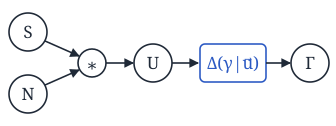
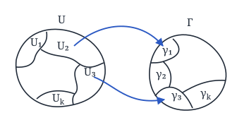
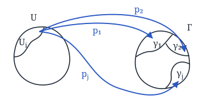
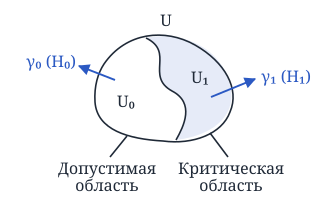

## Лекция 8. Теория оптимальных методов радиоприёма

*12.11.2026*

**Помехоустойчивость** — способность системы противостоять вредному действию помех.

**Потенциальная помехоустойчивость** — максимально достижимая помехоустойчивость.

**Оптимальный приёмник** — приёмник, обеспечивающий потенциальную помехоустойчивость.

> Оптимальность определяется при заданных условиях и по выбранному критерию.

Принятый сигнал

$$
u(t)=F\bigl[s(t,\vec\lambda),n(t)\bigr],
$$

где $u(t)$ — сигнал на входе приёмника, $s(t,\vec\lambda)$ — полезный сигнал, $\vec\lambda$ — вектор параметров, $n(t)$ — помеха.

## Основные задачи радиоприёма

### 1. Обнаружение сигнала

При аддитивной помехе

$$
u(t)=\theta s(t,\vec\lambda)+n(t),
$$

где $\theta$ — случайная величина. Значение $\theta=1$ соответствует появлению полезного сигнала с вероятностью $p_1$, а $\theta=0$ — отсутствию сигнала с вероятностью $p_0$.

По принятому сигналу $u(t)$ требуется наилучшим образом принять решение о наличии или отсутствии полезного сигнала $s(t,\vec\lambda)$ на входе.

### 2. Различение сигналов

$$
\begin{aligned}
&u(t)=s_i(t,\vec\lambda)+n(t),\\
&i=1,2,\ldots,m,\quad m\ge 2,\\
&\sum_{i=1}^{m}p_i=1.
\end{aligned}
$$

Здесь $p_i$ — вероятность появления сигнала $s_i(t,\vec\lambda)$. По принятому сигналу $u(t)$ требуется наилучшим образом решить, какой сигнал из ансамбля присутствует на входе.

### 3. Измерение параметров сигнала

$$
\begin{aligned}
&u(t)=s(t,\lambda)+n(t),\\
&\lambda=\mathrm{const}\quad\text{при }0\le t\le T,
\end{aligned}
$$

где $T$ — длительность полезного сигнала. Плотность вероятности $W(\lambda)$ известна. По принятому сигналу $u(t)$ требуется наилучшим образом измерить параметр $\lambda$.

### 4. Фильтрация сигнала

Параметр $\lambda(t)$ и полезный сигнал $s(t,\lambda(t))$ — случайные процессы (СП).

$$
u(t)=F\bigl[s(t,\lambda(t)),n(t)\bigr].
$$

По принятому сигналу $u(t)$ требуется наилучшим образом выделить реализацию параметра $\lambda^{(i)}(t)$ или всего полезного сигнала $s(t,\lambda^{(i)}(t))$.

### 5. Разрешение сигналов

Если на входе системы присутствуют два и более полезных сигнала, отличающихся друг от друга параметром $\lambda$, требуется обнаружить их по отдельности и наилучшим образом оценить их параметры.

### 6. Распознавание образов

## Модели полезных сигналов и помех

### Детерминированный сигнал

$$
s(t)=A_0\cos(\omega_0t+\varphi_0).
$$

### Сигнал со случайной начальной фазой

$$
s(t)=A_0\cos(\omega_0t+\varphi),
$$

где $\varphi$ — случайная величина, равномерно распределённая на $[-\pi;\,\pi]$.

$$
W(\varphi)=\frac{1}{2\pi},
\qquad -\pi\le\varphi\le\pi.
$$

### Сигнал со случайными начальной фазой и амплитудой

$$
s(t)=a\cos(\omega_0t+\varphi).
$$

Фаза $\varphi$ равномерно распределена на $[-\pi;\,\pi]$, как в предыдущей модели. Амплитуда $a$ распределена по закону Рэлея.

$$
W(a)=\frac{a}{\sigma_a^2}
e^{-\frac{a^2}{2\sigma_a^2}},
\qquad a\ge 0.
$$

### Белый гауссовский шум

В конспекте для помехи $n(t)$ записаны гауссовская плотность и нулевое среднее

$$
\begin{aligned}
&W(n)=\frac{1}{\sqrt{2\pi}\,\sigma}
 e^{-\frac{n^2}{2\sigma^2}},\\
&m_n=0.
\end{aligned}
$$

В модели белого шума спектральная плотность постоянна, а корреляционная функция пропорциональна дельта-функции.

$$
S(\omega)=\frac{N_0}{2},
\qquad R(\tau)=\frac{N_0}{2}\delta(\tau).
$$

## Пространства сигналов и решающее правило

Принятый сигнал можно записать в виде

$$
u(t)=s(t,\vec\lambda)*n(t),
$$

где $*$ обозначает способ взаимодействия полезного сигнала и помехи, например сложение или умножение.

Из отсчётов в моменты $t_1,t_2,\ldots,t_n$ составляют векторы размерности $n$.

- $\vec u=(u_1,u_2,\ldots,u_n)$ — вектор принятого сигнала.
- $\vec s=(s_1,s_2,\ldots,s_n)$ — вектор полезного сигнала.
- $\vec n=(n_1,n_2,\ldots,n_n)$ — вектор помехового сигнала.

$$
\vec u=\vec s*\vec n.
$$

Пространство $U$ включает все принятые сигналы, $S$ — полезные, $N$ — помеховые. Известны способ взаимодействия $*$ и плотность распределения помехи

$$
W(\vec n)=W_n(n_1,n_2,\ldots,n_n).
$$

**Функция правдоподобия**

$$
W(\vec u\mid\vec s)
=W_n(u_1,u_2,\ldots,u_n\mid\vec s)
$$

характеризует степень соответствия вектора принятого сигнала тому или иному вектору полезного сигнала. Совместная плотность

$$
W(\vec u,\vec s)=W(\vec s)\,W(\vec u\mid\vec s).
$$

### Решения

$\gamma_0,\gamma_1,\ldots,\gamma_k$ — возможные решения, $\Gamma$ — пространство решений. По принятой выборке $\vec u$ при известном распределении помехового сигнала и способе взаимодействия устройство должно принять решение $\gamma_i$. Выбор решения задаёт **решающее правило** $\Delta(\gamma\mid\vec u)$.

**Нерандомизированное правило** ставит в соответствие каждой области пространства принятых сигналов одно решение.

При **рандомизированном правиле** одной области могут соответствовать разные решения $\gamma_j$. Вероятности $p_j$ этих решений в сумме дают единицу.

$$
\sum_j p_j=1.
$$

### Функция потерь и средний риск

**Функция потерь** $\Pi(\vec s_i,\gamma_j)$ задана заранее. В конспекте для неё приведены условия

$$
\begin{aligned}
&\Pi(\vec s_i,\gamma_j)>0, &&i\ne j,\\
&\Pi(\vec s_i,\gamma_i)\le 0,\\
&\Pi(\vec s_i,\gamma_j)>\Pi(\vec s_i,\gamma_i), &&i\ne j.
\end{aligned}
$$

Оптимальное решение принимают по сигналу $\vec u$ на основе априорных данных о пространствах полезных сигналов и помех, распределениях вероятностей на этих пространствах, способе взаимодействия сигнала и помехи и заданной функции потерь.

**Средний риск** $R$ характеризует средние потери при принятии решения.

$$
\begin{aligned}
&R=M\{\Pi(\vec s_i,\gamma_j)\}\\
&=\sum_i\sum_j\Pi(\vec s_i,\gamma_j)\,W(\vec s_i,\gamma_j)\\
&=\sum_i\sum_j\Pi(\vec s_i,\gamma_j)\,W(\vec s_i)
\,W(\gamma_j\mid\vec s_i).
\end{aligned}
$$

Если пространства $S$ и $\Gamma$ непрерывны,

$$
R=\int_S\int_\Gamma
\Pi(s,\gamma)\,W(s,\gamma)\,d\gamma\,ds.
$$

Для нерандомизированного правила, где $\gamma_u$ — решение по наблюдению $u$, риск можно записать через совместную плотность $W(s,u)$.

$$
R=\int_S\int_U
\Pi(s,\gamma_u)\,W(s,u)\,du\,ds.
$$

## Критерии оптимальности

### 1. Критерий Байеса

**Критерий Байеса** — критерий минимума среднего риска. Выбирают правило, обеспечивающее минимальное значение $R$.

$$
\begin{aligned}
&R=\int_S\int_U
\Pi(s,\gamma_u)\,W(s,u)\,du\,ds\\
&\to\min.
\end{aligned}
$$

### 2. Минимаксный критерий

**Минимаксный критерий** (критерий осторожного наблюдателя) обеспечивает минимальное значение максимального условного риска.

$$
R_{\vec s_i}=\sum_j
\Pi(\vec s_i,\gamma_j)\,W(\gamma_j\mid\vec s_i).
$$

$$
\begin{array}{l|rrrr}
\text{Правило} & \vec s_1 & \vec s_2 & \vec s_3 & \vec s_4\\
\hline
\Delta_1(\gamma\mid\vec u) & 13 & 11 & 7 & \mathbf{14}\\
\Delta_2(\gamma\mid\vec u) & 2 & 1 & \mathbf{21} & 3
\end{array}
$$

Максимальные условные риски равны 14 и 21. Выбирают правило $\Delta_1$.

### 3. Критерий минимума полной вероятности ошибки

**Критерий идеального наблюдателя** (критерий Котельникова — Зигерта) получается при одинаковых потерях $C>0$ за ошибочные решения и нулевых потерях за правильные.

$$
\Pi(\vec s_i,\gamma_j)=
\begin{cases}
C,& i\ne j,\\
0,& i=j.
\end{cases}
$$

$$
\begin{aligned}
&R=\sum_i\sum_j\Pi(\vec s_i,\gamma_j)\,W(\vec s_i,\gamma_j)\\
&=C\sum_i\sum_{j\ne i}W(\vec s_i,\gamma_j)\\
&=C\,P_{\text{ош}}\to\min.
\end{aligned}
$$

Здесь $P_{\text{ош}}$ — полная вероятность ошибочных решений.

### 4. Критерий максимума апостериорной плотности вероятности

При фиксированном $\vec u$ максимизируют по $\vec s$ апостериорную плотность

$$
W(\vec s\mid\vec u)=
\frac{W(\vec s)\,W(\vec u\mid\vec s)}{W(\vec u)}.
$$

Формула следует из двух разложений совместной плотности.

$$
\begin{aligned}
&W(\vec s,\vec u)=W(\vec s)\,W(\vec u\mid\vec s)\\
&=W(\vec u)\,W(\vec s\mid\vec u).
\end{aligned}
$$

### 5. Критерий максимума функции правдоподобия

При $W(\vec s)=\mathrm{const}$ максимум апостериорной плотности достигается там же, где максимум $W(\vec u\mid\vec s)$.

### 6. Критерий Неймана — Пирсона

Вероятность ошибок одного типа ограничивают заранее выбранной величиной, а вероятность ошибок другого типа минимизируют.

### 7. Критерий Вальда

**Критерий Вальда** (критерий последовательного наблюдателя) при заданных вероятностях ошибочных решений обеспечивает минимум среднего времени наблюдения, необходимого для принятия решения.

## Задача обнаружения сигнала

- $H_0$ — гипотеза об отсутствии полезного сигнала, $\gamma_0$ — решение о его отсутствии.
- $H_1$ — гипотеза о наличии полезного сигнала, $\gamma_1$ — решение о его наличии.

Для **простых гипотез** распределение принятого сигнала $u(t)$ определяется тем, какая из гипотез $H_0$, $H_1$ верна. Для **сложных гипотез** распределение зависит также от вектора параметров $\vec\lambda$.

$$
u(t)=\theta s(t)+n(t),
$$

где $\theta=1$ с вероятностью $p_1=p$, а $\theta=0$ с вероятностью $p_0=1-p$.

Пространство наблюдений $U$ делят на две области. В $U_0$ принимают решение $\gamma_0$, а в $U_1$ — решение $\gamma_1$. При проверке $H_0$ область $U_1$ критическая, а $U_0$ — область принятия $H_0$.

### Вероятности решений

**Правильное необнаружение** ($H_0$, $\gamma_0$)

$$
P_{\text{н}}=\int_{U_0}W(\vec u\mid H_0)\,d\vec u.
$$

**Правильное обнаружение** ($H_1$, $\gamma_1$)

$$
D=\int_{U_1}W(\vec u\mid H_1)\,d\vec u.
$$

**Ложная тревога** ($H_0$, $\gamma_1$)

$$
\alpha=\int_{U_1}W(\vec u\mid H_0)\,d\vec u.
$$

**Пропуск сигнала** ($H_1$, $\gamma_0$)

$$
\beta=\int_{U_0}W(\vec u\mid H_1)\,d\vec u.
$$

$$
\alpha+P_{\text{н}}=1,
\qquad \beta+D=1.
$$
