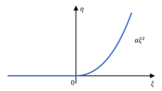
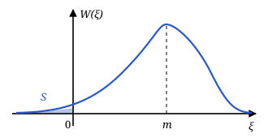
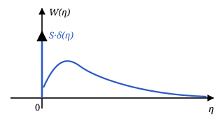

## Семинар 2. Нелинейные неинерционные преобразования

Задачи к лекциям 5–6: плотность вероятности, корреляционная функция и СПМ на выходе нелинейной неинерционной системы (ННС).

### Задача 1. Односторонний квадратичный детектор

На безынерционный односторонний квадратичный детектор

$$
\eta=\begin{cases}
\alpha\xi^2, & \xi\ge0,\\
0, & \xi<0,
\end{cases}
\qquad \alpha>0,\ \eta\ge0,
$$

поступает стационарный гауссовский шум с плотностью вероятности

$$
W(\xi)=\frac1{\sqrt{2\pi}\,\sigma}\,e^{-\frac{(\xi-m)^2}{2\sigma^2}}.
$$

Определить плотность вероятности $W_\eta(\eta)$ на выходе.

#### Решение

**Положительные входы.** Для $\xi\ge0$ обратная функция однозначна:

$$
\xi^2=\frac{\eta}{\alpha}\ \Rightarrow\ \xi=\sqrt{\frac{\eta}{\alpha}},
\qquad \alpha>0,\ \xi\ge0.
$$

Её производная:

$$
\frac{d\xi}{d\eta}=\frac1{\sqrt\alpha}\cdot\frac1{2\sqrt\eta}
=\frac1{2\sqrt{\alpha\eta}}.
$$

По формуле преобразования плотности при однозначной обратной функции:

$$
\begin{aligned}
W_\eta(\eta)&=W(\xi)\left|\frac{d\xi}{d\eta}\right|=\\
&=\frac1{\sqrt{2\pi}\,\sigma}\,e^{-\frac{(\xi-m)^2}{2\sigma^2}}
\left|\frac1{2\sqrt{\alpha\eta}}\right|=\\
&=\frac1{2\sigma\sqrt{2\pi\alpha\eta}}\,
e^{-\frac{\left(\sqrt{\eta/\alpha}-m\right)^2}{2\sigma^2}},
\qquad \eta>0.
\end{aligned}
$$

Модуль можно опустить: при $\eta>0$ производная положительна.

**Отрицательные входы.** Все $\xi<0$ переходят в одно значение $\eta=0$. Вероятность этого значения:

$$
S=\int_{-\infty}^{0}W(\xi)\,d\xi
=\int_{-\infty}^{0}\frac1{\sqrt{2\pi}\,\sigma}\,
e^{-\frac{(\xi-m)^2}{2\sigma^2}}\,d\xi.
$$

Замена $t=\dfrac{\xi-m}{\sigma}$, $\xi=t\sigma+m$, $d\xi=\sigma\,dt$; верхний предел становится $-m/\sigma$:

$$
\begin{aligned}
S&=\int_{-\infty}^{-m/\sigma}\frac1{\sqrt{2\pi}}\,e^{-\frac{t^2}{2}}\,dt=\\
&=\Phi\left(-\frac{m}{\sigma}\right)
=1-\Phi\left(\frac{m}{\sigma}\right),
\end{aligned}
$$

где

$$
\Phi(x)=\frac1{\sqrt{2\pi}}\int_{-\infty}^{x}e^{-\frac{t^2}{2}}\,dt
$$

— интеграл вероятности. В плотности выхода эта вероятность даёт дельта-функцию $S\,\delta(\eta)$.

**Ответ:**

$$
\begin{aligned}
W_\eta(\eta)&=\frac1{2\sigma\sqrt{2\pi\alpha\eta}}\,
e^{-\frac{\left(\sqrt{\eta/\alpha}-m\right)^2}{2\sigma^2}}+\\
&+\left[1-\Phi\left(\frac{m}{\sigma}\right)\right]\delta(\eta),
\qquad \eta\ge0,
\end{aligned}
$$

и $W_\eta(\eta)=0$ при $\eta<0$.

### Задача 2. Корреляционная функция и СПМ после квадратора

На вход нелинейного устройства с характеристикой $\eta=\xi^2$ поступает стационарный центрированный гауссовский шум с корреляционной функцией

$$
R_\xi(\tau)=\sigma_\xi^2\,e^{-\alpha|\tau|}.
$$

Найти корреляционную функцию $R_\eta(\tau)$ и СПМ $S_\eta(\omega)$ на выходе.

#### Решение

По определению

$$
\begin{aligned}
R_\eta(\tau)&=M\{[\eta(t)-m_\eta][\eta(t+\tau)-m_\eta]\}=\\
&=K_\eta(\tau)-m_\eta^2.
\end{aligned}
$$

**Ковариационная функция.** Так как $m_\xi=0$, начальный момент совпадает с центральным:

$$
\begin{aligned}
K_\eta(\tau)&=M\{\eta(t)\,\eta(t+\tau)\}=\\
&=M\{\xi^2(t)\,\xi^2(t+\tau)\}=\\
&=M_{\xi22}(\tau)=\mu_{\xi22}(\tau).
\end{aligned}
$$

По формуле двумерных моментов стационарного центрированного ГСП из лекции 6:

$$
\begin{aligned}
\mu_{ij}(\tau)&=\sigma^{i+j}\sum_{k=0}^{\infty}
\frac{r_\xi^k(\tau)}{k!}\,N_{ik}N_{jk},\\
\mu_{\xi22}(\tau)&=\sigma_\xi^4\sum_{k=0}^{\infty}
\frac{r_\xi^k(\tau)}{k!}\,N_{2k}N_{2k}.
\end{aligned}
$$

Коэффициенты: $N_{20}=1$, $N_{21}=0$, $N_{22}=2\cdot1=2$, $N_{23}=0$, при $k>2$ $N_{2k}=0$. Поэтому

$$
\begin{aligned}
\mu_{\xi22}(\tau)&=\sigma_\xi^4\left(\frac{r_\xi^0(\tau)}{0!}\cdot1^2
+\frac{r_\xi^2(\tau)}{2!}\cdot2^2\right)=\\
&=\sigma_\xi^4\bigl(1+2r_\xi^2(\tau)\bigr)=\\
&=\sigma_\xi^4\left(1+2\left[\frac{R_\xi(\tau)}{R_\xi(0)}\right]^2\right).
\end{aligned}
$$

Нормированная корреляционная функция входа:

$$
r_\xi(\tau)=\frac{R_\xi(\tau)}{R_\xi(0)}
=\frac{\sigma_\xi^2e^{-\alpha|\tau|}}{\sigma_\xi^2}=e^{-\alpha|\tau|}.
$$

Итак,

$$
K_\eta(\tau)=\sigma_\xi^4\left(1+2e^{-2\alpha|\tau|}\right).
$$

**Среднее.** Так как $m_\xi=0$,

$$
\begin{aligned}
m_\eta&=M\{\eta(t)\}=M\{\xi^2(t)\}=\\
&=M_{\xi2}=\mu_{\xi2}=\sigma_\xi^2.
\end{aligned}
$$

**Корреляционная функция:**

$$
\begin{aligned}
R_\eta(\tau)&=\sigma_\xi^4\left(1+2e^{-2\alpha|\tau|}\right)-\sigma_\xi^4=\\
&=2\sigma_\xi^4\,e^{-2\alpha|\tau|}.
\end{aligned}
$$

**СПМ** находится по ковариационной функции:

$$
\begin{aligned}
S_\eta(\omega)&=\int_{-\infty}^{\infty}K_\eta(\tau)\,e^{-j\omega\tau}\,d\tau=\\
&=\sigma_\xi^4\,(\text{I}+\text{II}),\\
\text{I}&=\int_{-\infty}^{\infty}e^{-j\omega\tau}\,d\tau,\\
\text{II}&=2\int_{-\infty}^{\infty}e^{-2\alpha|\tau|-j\omega\tau}\,d\tau.
\end{aligned}
$$

Слагаемое I даёт дельта-функцию:

$$
\text{I}=2\pi\int_{-\infty}^{\infty}\frac1{2\pi}\,e^{-j\omega\tau}\,d\tau
=2\pi\,\delta(\omega).
$$

Слагаемое II: разбиваем интеграл по знаку $\tau$:

$$
\begin{aligned}
\text{II}&=2\int_{-\infty}^{0}e^{\tau(2\alpha-j\omega)}\,d\tau+\\
&+2\int_{0}^{\infty}e^{-\tau(2\alpha+j\omega)}\,d\tau=\\
&=\frac{2}{2\alpha-j\omega}\left.e^{\tau(2\alpha-j\omega)}\right|_{-\infty}^{0}-\\
&-\frac{2}{2\alpha+j\omega}\left.e^{-\tau(2\alpha+j\omega)}\right|_{0}^{\infty}=\\
&=\frac{2}{2\alpha-j\omega}+\frac{2}{2\alpha+j\omega}=\\
&=2\cdot\frac{2\alpha+j\omega+2\alpha-j\omega}{(2\alpha)^2-(j\omega)^2}=\\
&=\frac{8\alpha}{4\alpha^2+\omega^2}.
\end{aligned}
$$

**Ответ:**

$$
\begin{aligned}
R_\eta(\tau)&=2\sigma_\xi^4\,e^{-2\alpha|\tau|},\\
S_\eta(\omega)&=2\pi\sigma_\xi^4\,\delta(\omega)
+\frac{8\sigma_\xi^4\alpha}{4\alpha^2+\omega^2}.
\end{aligned}
$$

Дельта-функция на нулевой частоте соответствует постоянной составляющей $m_\eta=\sigma_\xi^2$; непрерывная часть — флуктуациям выхода, её площадь, делённая на $2\pi$, равна $R_\eta(0)=2\sigma_\xi^4$.

### Задача 3. Линейная система и кубический преобразователь

Гауссовский шум или процесс $x(t)$ с известной СПМ $S_x(\omega)$ или корреляционной функцией $R_x(\tau)$ проходит через линейную инерционную систему (ЛИС) с частотной характеристикой $K(j\omega)$, а затем через нелинейное неинерционное звено $z=y^3$.

Найти: $W(y)$, $W_z(z)$, $R_z(\tau)$, $S_z(\omega)$, $m_z$, $D_z$.

#### Решение

*В тетради решения нет; оно составлено по формулам лекций 3–6.*

Считаем $x(t)$ стационарным центрированным гауссовским шумом, $m_x=0$, а режим ЛИС — установившимся.

**1. Выход ЛИС.** Линейное преобразование гауссовского процесса даёт гауссовский процесс (лекция 4), поэтому $y(t)$ — стационарный центрированный ГСП. Его СПМ, корреляционная функция и дисперсия:

$$
\begin{aligned}
S_y(\omega)&=S_x(\omega)\,|K(j\omega)|^2,\\
R_y(\tau)&=\frac1{2\pi}\int_{-\infty}^{\infty}S_y(\omega)\,e^{j\omega\tau}\,d\omega,\\
\sigma_y^2&=R_y(0)=\frac1{2\pi}\int_{-\infty}^{\infty}
S_x(\omega)\,|K(j\omega)|^2\,d\omega.
\end{aligned}
$$

Среднее $m_y=m_xK(0)=0$, и

$$
W(y)=\frac1{\sqrt{2\pi}\,\sigma_y}\,e^{-\frac{y^2}{2\sigma_y^2}}.
$$

**2. Плотность $W_z(z)$.** Функция $z=y^3$ монотонна, обратная функция однозначна: $y=\sqrt[3]{z}$ (действительный кубический корень, знак сохраняется). Производная

$$
\frac{dy}{dz}=\frac1{3\sqrt[3]{z^2}},\qquad z\ne0.
$$

По формуле преобразования плотности:

$$
\begin{aligned}
W_z(z)&=W(y)\left|\frac{dy}{dz}\right|=\\
&=\frac1{3\sqrt{2\pi}\,\sigma_y\sqrt[3]{z^2}}\,
e^{-\frac{\sqrt[3]{z^2}}{2\sigma_y^2}},\qquad z\ne0.
\end{aligned}
$$

При $z\to0$ плотность неограниченно растёт, но остаётся интегрируемой: куб сжимает малые значения $y$ к нулю.

**3. Среднее.** Нечётный момент центрированной гауссовской величины равен нулю:

$$
m_z=M\{y^3(t)\}=\mu_3=0.
$$

**4. Корреляционная функция.** Так как $m_z=0$, $R_z(\tau)=K_z(\tau)=M\{y^3(t)\,y^3(t+\tau)\}=\mu_{33}(\tau)$. По формуле двумерных моментов ГСП (лекция 6) с $r_y(\tau)=R_y(\tau)/\sigma_y^2$:

$$
\mu_{33}(\tau)=\sigma_y^6\sum_{k=0}^{\infty}
\frac{r_y^k(\tau)}{k!}\,N_{3k}^2.
$$

Коэффициенты: $N_{30}=N_{32}=0$ (разная чётность), $N_{3k}=0$ при $k>3$,

$$
\begin{aligned}
N_{31}&=-3\cdot1=-3,\\
N_{33}&=-3\cdot2\cdot1=-6.
\end{aligned}
$$

Поэтому

$$
\begin{aligned}
R_z(\tau)&=\sigma_y^6\left(\frac{r_y}{1!}\cdot9
+\frac{r_y^3}{3!}\cdot36\right)=\\
&=\sigma_y^6\bigl(9r_y(\tau)+6r_y^3(\tau)\bigr)=\\
&=9\sigma_y^4R_y(\tau)+6R_y^3(\tau).
\end{aligned}
$$

> Проверка по теореме Иссерлиса: в $M\{y_1y_1y_1\,y_2y_2y_2\}$ девять разбиений на пары дают $\sigma_y^4R_y$, шесть — $R_y^3$.

**5. Дисперсия:**

$$
D_z=R_z(0)=9\sigma_y^6+6\sigma_y^6=15\sigma_y^6.
$$

Это совпадает с $\mu_6=1\cdot3\cdot5\,\sigma_y^6$.

**6. СПМ.** Преобразование Фурье первого слагаемого даёт $9\sigma_y^4S_y(\omega)$. Преобразование произведения $R_y^3$ — свёртка спектров, делённая на $(2\pi)^2$:

$$
\begin{aligned}
&S_z(\omega)=9\sigma_y^4\,S_x(\omega)\,|K(j\omega)|^2+\\
&+\frac{6}{(2\pi)^2}\iint_{-\infty}^{\infty}
S_y(\omega_1)\,S_y(\omega_2)\times\\
&\qquad\times S_y(\omega-\omega_1-\omega_2)\,d\omega_1\,d\omega_2.
\end{aligned}
$$

Первое слагаемое повторяет форму спектра $y$, второе расширяет спектр примерно втрое: так кубическая нелинейность порождает составляющие на новых частотах.

#### Пример: белый шум и RC-цепь

*Пример добавлен при оцифровке.* Пусть $S_x(\omega)=N_0/2$ и $K(j\omega)=\dfrac1{1+j\omega T}$. Тогда

$$
\begin{aligned}
S_y(\omega)&=\frac{N_0/2}{1+\omega^2T^2},\\
R_y(\tau)&=\sigma_y^2e^{-|\tau|/T},\qquad
\sigma_y^2=\frac{N_0}{4T}.
\end{aligned}
$$

Подставляем:

$$
\begin{aligned}
R_z(\tau)&=9\sigma_y^6e^{-|\tau|/T}+6\sigma_y^6e^{-3|\tau|/T},\\
S_z(\omega)&=\frac{18\sigma_y^6T}{1+\omega^2T^2}
+\frac{36\sigma_y^6T}{9+\omega^2T^2},\\
D_z&=15\sigma_y^6,\qquad m_z=0.
\end{aligned}
$$

Здесь использовано $\int_{-\infty}^{\infty}e^{-a|\tau|}e^{-j\omega\tau}\,d\tau=\dfrac{2a}{a^2+\omega^2}$ — тот же интеграл, что в задаче 2. Второе слагаемое спектра втрое шире первого.
