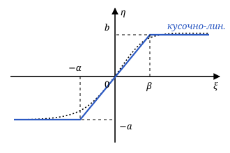

# Ответы к тестам по статистической радиотехнике

Лекции 1–4 — известные вопросы опросов. Лекции 5 и 6 — предполагаемые темы для подготовки; вопросы преподавателя пока неизвестны.

## Лекция 1

### 1 Определение дисперсии

**Дисперсия СП** — математическое ожидание квадрата отклонения значения процесса от его математического ожидания. Это одномерная центральная моментная функция второго порядка; она характеризует разброс значений относительно среднего.

$$
\begin{aligned}
D_x(t)&=\mu_2(t)\\
&=M\{[x(t)-m_x(t)]^2\}.
\end{aligned}
$$

### 2 Классификация СП по области определения и области возможных значений

Область определения задаёт моменты времени, область возможных значений — амплитуды процесса.

- **Дискретная случайная последовательность:** время дискретно, значения дискретны.
- **Случайная последовательность:** время дискретно, значения непрерывны.
- **Дискретный СП:** время непрерывно, значения дискретны.
- **Непрерывный СП:** время и значения непрерывны, реализации непрерывны.

В лекции также выделены **непрерывнозначные СП с разрывами первого рода**: время и значения непрерывны, но реализации могут иметь скачки. **Квазидетерминированные СП** имеют заданную форму со случайными параметрами, например колебание со случайной фазой.

$$
\xi(t)=A(t)\cos[\omega_0t+\varphi],
$$

где $\varphi$ — случайная фаза.

### 3 Центральная моментная функция СП

**Центральная моментная функция** — математическое ожидание произведения отклонений значений СП от их математических ожиданий, взятых в заданные моменты времени и возведённых в заданные степени. Её порядок равен сумме этих степеней.

$$
\begin{aligned}
&\mu_{i_1\ldots i_n}(t_1,\ldots,t_n)\\
&\quad=M\left\{\prod_{k=1}^n(x_k-m_k)^{i_k}\right\},\\
&\nu=i_1+\cdots+i_n.
\end{aligned}
$$

Здесь $x_k=x(t_k)$, $m_k=m_x(t_k)$, $\nu$ — порядок. Например, $\mu_2$ — дисперсия, $\mu_{11}$ — корреляционная функция.

### 4 Определение многомерной функции распределения

**Многомерная функция распределения СП** — вероятность того, что значения процесса во всех выбранных моментах времени **одновременно** окажутся меньше соответствующих заданных порогов. Она описывает совместное распределение нескольких отсчётов процесса.

$$
\begin{aligned}
&F_n(x_1,\ldots,x_n;t_1,\ldots,t_n)\\
&\quad=P\{x(t_k)<x_k,\ k=1,\ldots,n\}.
\end{aligned}
$$

Здесь $x_1,\ldots,x_n$ — пороги для соответствующих моментов времени.

## Лекция 2

### 1 Свойства нормированной корреляционной функции

Для действительного стационарного СП при $D_x=R_x(0)>0$ **нормированная корреляционная функция**:

$$
r_x(\tau)=\frac{R_x(\tau)}{R_x(0)}.
$$

- $r_x(0)=1$ — при нулевом сдвиге равна единице.
- $r_x(\tau)=r_x(-\tau)$ — чётна.
- $|r_x(\tau)|\le1$ — модуль не превышает единицы.
- $r_x(\tau)\to0$ при $|\tau|\to\infty$ **если корреляция затухает**. Это не обязательное свойство каждого стационарного процесса.

### 2 Условия стационарности в широком смысле

При конечных вторых моментах:

- Математическое ожидание и дисперсия **постоянны во времени**.
- Корреляционная и ковариационная функции зависят **только от разности моментов времени**, а не от каждого момента отдельно.

$$
\begin{aligned}
m_x(t)&=\mathrm{const},\\
D_x(t)&=\mathrm{const},\\
R_x(t_1,t_2)&=R_x(\tau),\\
K_x(t_1,t_2)&=K_x(\tau),\\
\tau&=t_2-t_1.
\end{aligned}
$$

### 3 Условия стационарности в узком смысле

**Все многомерные распределения** СП не меняются при одинаковом сдвиге всех моментов времени. Условие должно выполняться для любого числа отсчётов, любых моментов и любого общего сдвига. Иначе говоря, перенос начала наблюдения не меняет статистические свойства процесса.

Для процесса с плотностями вероятности:

$$
\begin{aligned}
&W_n(x_1,\ldots,x_n;t_1,\ldots,t_n)\\
&\quad=W_n(x_1,\ldots,x_n;\\
&\qquad\qquad t_1-\tau,\ldots,t_n-\tau).
\end{aligned}
$$

### 4 Что такое интервал корреляции

**Интервал корреляции** — характерное время между отсчётами, после которого их корреляцией можно пренебречь. Он характеризует длительность статистической связи значений процесса.

Оценка по площади огибающей $f(\tau)$ корреляционной функции:

$$
\tau_{\text{к}}=\frac1{2R_x(0)}
\int_{-\infty}^{+\infty}|f(\tau)|\,d\tau.
$$

## Лекция 3

### 1 Физический смысл спектральной плотности мощности

**СПМ описывает распределение средней мощности процесса по частотам:** показывает, сколько мощности приходится на единицу частотного интервала. Площадь под спектром с учётом принятого нормирования даёт средний квадрат процесса, а для центрированного СП — его дисперсию.

Для центрированного СП и двухстороннего спектра по угловой частоте $\omega$:

$$
D_x=\frac1{2\pi}\int_{-\infty}^{+\infty}S(\omega)\,d\omega.
$$

### 2 Определение спектральной плотности мощности

**Спектральная плотность мощности стационарного СП** — преобразование Фурье его ковариационной функции, то есть среднего произведения двух значений процесса, взятых с заданным временным сдвигом.

$$
\begin{aligned}
S(\omega)&=\int_{-\infty}^{+\infty}
K_x(\tau)e^{-j\omega\tau}\,d\tau,\\
K_x(\tau)&=M\{x(t)x(t+\tau)\}.
\end{aligned}
$$

Для **центрированного СП** ковариационная и корреляционная функции совпадают, поэтому СПМ равна преобразованию Фурье корреляционной функции.

В обозначениях курса $K_x$ — нецентрированный второй момент, $R_x$ — центрированный; $j=\sqrt{-1}$.

## Лекция 4

### 1 Алгоритм получения плотности вероятности на выходе ЛИС

Чтобы найти плотность вероятности $W(\eta;t)$ на выходе линейной инерционной системы:

1. Найти **начальные моментные функции входного СП**.
2. По ним и характеристикам системы найти **начальные моментные функции выходного СП**.
3. По моментам выхода построить **характеристическую функцию** (при допустимости разложения по моментам):

$$
Q_\eta(ju;t)=\sum_{k=0}^{\infty}\frac{(ju)^k}{k!}M_{\eta k}(t),
$$

где $M_{\eta k}(t)=M\{\eta^k(t)\}$, $M_{\eta0}=1$.

4. Восстановить **плотность вероятности** обратным преобразованием Фурье:

$$
W(\eta;t)=\frac1{2\pi}\int_{-\infty}^{+\infty}
Q_\eta(ju;t)e^{-ju\eta}\,du.
$$

Итого: **моменты входа → моменты выхода → характеристическая функция → плотность**.

## Лекция 5 — предполагаемые темы опроса

**Вопросы опроса пока неизвестны.** Ниже — предполагаемые вопросы для самостоятельной подготовки по конспекту лекции 5, а не подтверждённый список преподавателя.

Обозначения: $\xi(t)$ — вход, $\eta(t)$ — выход; $h(t)$ — импульсная характеристика, $K(j\omega)$ — частотная характеристика системы.

### 1 Как найти корреляционную функцию и дисперсию на выходе ЛИС

При нулевых начальных условиях корреляция выхода определяется корреляцией входа и импульсной характеристикой:

$$
\begin{aligned}
R_\eta(t_1,t_2)&=\int_0^{t_1}\!\int_0^{t_2}
R_\xi(t_1-u,t_2-v)\\
&\quad\times h(u)h(v)\,dv\,du,\\
D_\eta(t)&=R_\eta(t,t).
\end{aligned}
$$

Та же связь действует для ковариационных функций $K_\xi$ и $K_\eta$. Для стационарного входа в установившемся режиме пределы заменяются на $\infty$, аргумент входной функции — на $\tau+u-v$; тогда $D_\eta=R_\eta(0)$.

### 2 Как связаны спектральные плотности мощности входа и выхода ЛИС

Для стационарного входа при существовании установившегося режима:

$$
S_\eta(\omega)=S_\xi(\omega)|K(j\omega)|^2.
$$

Система умножает мощность каждой частотной составляющей на **квадрат модуля частотной характеристики**. Для центрированного выхода дисперсия равна площади его СПМ, делённой на $2\pi$.

### 3 Чему равны взаимная СПМ и когерентность входа и выхода ЛИС

В стационарном установившемся режиме, при порядке отсчётов $M\{\xi(t)\eta(t+\tau)\}$:

$$
\begin{aligned}
S_{\xi\eta}(\omega)&=S_\xi(\omega)K(j\omega),\\
\gamma^2(\omega)&=\frac{|S_{\xi\eta}(\omega)|^2}
{S_\xi(\omega)S_\eta(\omega)}=1.
\end{aligned}
$$

Когерентность равна единице там, где знаменатель ненулевой: выход связан с входом линейным преобразованием. Взаимная СПМ, в отличие от собственной, сохраняет информацию о фазе системы.

### 4 Определение производной СП в среднеквадратическом смысле

Процесс $\eta(t)$ — **среднеквадратическая производная** $\xi(t)$, если средний квадрат ошибки разностного отношения стремится к нулю:

$$
\lim_{\Delta t\to0}M\left\{
\left[\eta(t)-\frac{\xi(t+\Delta t)-\xi(t)}{\Delta t}\right]^2
\right\}=0.
$$

Обозначение: $\eta(t)=d\xi(t)/dt$.

### 5 Как меняются характеристики СП при дифференцировании

Среднее производной $m_\eta(t)=dm_\xi(t)/dt$. Для стационарного входа при существовании среднеквадратической производной:

$$
\begin{aligned}
m_\eta&=0,\\
K_\eta(\tau)&=-K_\xi''(\tau),\\
S_\eta(\omega)&=\omega^2S_\xi(\omega),\\
D_\eta&=\frac1{2\pi}\int_{-\infty}^{+\infty}
\omega^2S_\xi(\omega)\,d\omega<\infty.
\end{aligned}
$$

Дифференцирование **усиливает высокие частоты**. Конечность последнего интеграла — условие существования производной в среднем квадрате; для степенного хвоста $S_\xi\sim C|\omega|^{-p}$ требуется $p>3$.

### 6 Определение интеграла СП в среднеквадратическом смысле

**Среднеквадратический интеграл** — предел интегральных сумм, при котором средний квадрат ошибки стремится к нулю. При $\Delta t=t/N$:

$$
\begin{aligned}
&\lim_{N\to\infty}M\left\{
\left[\eta(t)-\Delta t\sum_{k=1}^{N}\xi(k\Delta t)\right]^2
\right\}=0,\\
&\eta(t)=\int_0^t\xi(u)\,du.
\end{aligned}
$$

Интеграл накапливает значения процесса за время от $0$ до $t$.

### 7 Как меняются характеристики СП при интегрировании

Для $\eta(t)=\int_0^t\xi(u)\,du$:

$$
\begin{aligned}
m_\eta(t)&=\int_0^t m_\xi(u)\,du,\\
R_\eta(t_1,t_2)&=\int_0^{t_1}\!\int_0^{t_2}R_\xi(u,v)\,dv\,du,\\
D_\eta(t)&=R_\eta(t,t).
\end{aligned}
$$

Даже при стационарном входе интеграл от $0$ до $t$ обычно **нестационарен**; при $m_\xi\ne0$ его среднее $m_\eta(t)=m_\xi t$ растёт со временем.

Интегратор усиливает **низкие частоты**: $K(j\omega)=1/(j\omega)$ при $\omega\ne0$. Соотношение $S_\eta(\omega)=S_\xi(\omega)/\omega^2$ применимо только при существовании стационарного выхода.

### 8 Как найти плотность вероятности после нелинейного неинерционного преобразования

Для $\eta=\varphi(\xi)$ и однозначной обратной функции $\xi=\Psi(\eta)$:

$$
W_\eta(\eta)=W_\xi[\Psi(\eta)]
\left|\frac{d\Psi(\eta)}{d\eta}\right|.
$$

Если одному значению выхода соответствуют несколько допустимых входных значений $\xi_i=\Psi_i(\eta)$, складываются вклады всех обратных ветвей:

$$
W_\eta(\eta)=\sum_{i=1}^k W_\xi[\Psi_i(\eta)]
\left|\frac{d\Psi_i(\eta)}{d\eta}\right|.
$$

Смысл — **сохранение вероятности**: модуль производной учитывает изменение ширины интервала. Формулы применяются на гладких обратных ветвях для каждого фиксированного момента времени.

## Лекция 6 — предполагаемые темы опроса

**Вопросы опроса пока неизвестны.** Ниже — предполагаемые вопросы для самостоятельной подготовки по конспекту лекции 6, а не подтверждённый список преподавателя.

Обозначения: $\xi$ — вход, $\eta$ — выход нелинейной неинерционной системы (ННС), $\varphi$ — её характеристика, $\Psi$ — обратная функция.

### 1 Как найти плотность вероятности на выходе ННС с n входами и n выходами

По обратной характеристике $\xi_i=\Psi_i(\eta_1,\ldots,\eta_n)$ плотность выхода равна плотности входа, умноженной на модуль якобиана:

$$
\begin{aligned}
&W_n(\eta_1,\ldots,\eta_n)=\\
&=W_n(\Psi_1,\ldots,\Psi_n)\,|D|,\qquad
D=\det\left[\frac{\partial\Psi_j}{\partial\eta_i}\right].
\end{aligned}
$$

$D$ — **якобиан преобразования**, определитель матрицы $n\times n$ из частных производных обратных функций.

### 2 Как найти плотность функции двух случайных величин

Для $\eta_2=\varphi_2(\xi_1,\xi_2)$ вводят вспомогательный выход $\eta_1=\xi_1$. Тогда $\xi_1=\eta_1$, $\xi_2=\Psi_2(\eta_1,\eta_2)$, $D=\partial\Psi_2/\partial\eta_2$, и вспомогательная переменная убирается интегрированием:

$$
W(\eta_2)=\int_{-\infty}^{\infty}
W_2\bigl(\eta_1,\Psi_2(\eta_1,\eta_2)\bigr)
\left|\frac{\partial\Psi_2}{\partial\eta_2}\right|d\eta_1.
$$

### 3 Плотность суммы, разности, произведения и частного двух случайных величин

$$
\begin{aligned}
&\xi_1+\xi_2:\ \int W_2(\eta_1,\eta_2-\eta_1)\,d\eta_1,\\
&\xi_1-\xi_2:\ \int W_2(\eta_1,\eta_1-\eta_2)\,d\eta_1,\\
&\xi_1\xi_2:\ \int W_2\left(\eta_1,\frac{\eta_2}{\eta_1}\right)
\frac{d\eta_1}{|\eta_1|},\\
&\frac{\xi_1}{\xi_2}:\ \int W_2\left(\eta_1,\frac{\eta_1}{\eta_2}\right)
\frac{|\eta_1|}{\eta_2^2}\,d\eta_1.
\end{aligned}
$$

Интегралы берутся по $\eta_1$ от $-\infty$ до $\infty$. Для независимых $\xi_1$ и $\xi_2$ плотность суммы — **свёртка**: $W(\eta_2)=\int W_{\xi_1}(\eta_1)W_{\xi_2}(\eta_2-\eta_1)\,d\eta_1$; сумма двух равномерных величин даёт треугольную плотность.

### 4 Как найти среднее и ковариационную функцию на выходе ННС

Для $\eta(t)=\varphi(\xi(t))$:

$$
\begin{aligned}
m_\eta(t)&=\int_{-\infty}^{\infty}\varphi(\xi)\,W(\xi;t)\,d\xi,\\
K_\eta(t_1,t_2)&=\iint_{-\infty}^{\infty}\varphi(\xi_1)\varphi(\xi_2)\\
&\quad\times W_2(\xi_1,\xi_2;t_1,t_2)\,d\xi_1\,d\xi_2.
\end{aligned}
$$

СПМ стационарного выхода — преобразование Фурье от $K_\eta(\tau)$. Для вычисления характеристику аппроксимируют: **полиномиальная** или **кусочно-линейная** аппроксимация.

### 5 Полиномиальная аппроксимация: моменты выхода

Если $\varphi$ аналитична в окрестности $\xi=0$:

$$
\begin{aligned}
\varphi[\xi(t)]&=a_0+a_1\xi(t)+\ldots+a_n\xi^n(t),\\
a_k&=\frac1{k!}\left.\frac{d^k\varphi}{d\xi^k}\right|_{\xi=0},\\
m_\eta(t)&=a_0+a_1M_{1\xi}(t)+\ldots+a_nM_{n\xi}(t).
\end{aligned}
$$

Ковариация $K_\eta(t_1,t_2)$ выражается через одномерные моменты $M_{k\xi}$ до порядка $n$ и двумерные $M_{ij\xi}(t_1,t_2)=M\{\xi^i(t_1)\xi^j(t_2)\}$, $i,j=1,\ldots,n$.

### 6 Моменты стационарного центрированного ГСП

**Теорема Иссерлиса:** для центрированных совместно гауссовских величин среднее произведения равно сумме по всем разбиениям сомножителей на пары произведений попарных моментов; моменты нечётного порядка равны нулю:

$$
\begin{aligned}
&M\{x_1x_2x_3x_4\}=M\{x_1x_2\}M\{x_3x_4\}+\\
&\quad+M\{x_1x_3\}M\{x_2x_4\}+M\{x_1x_4\}M\{x_2x_3\}.
\end{aligned}
$$

Отсюда одномерные центральные моменты:

$$
\mu_k=\begin{cases}
1\cdot3\cdot5\cdots(k-1)\,\sigma^k, & k\text{ — чётное},\\
0, & k\text{ — нечётное}.
\end{cases}
$$

Двумерные — также через нормированную корреляционную функцию $r_\xi(\tau)$:

$$
\mu_{ij}(\tau)=\sigma^{i+j}\sum_{k=0}^{\infty}
\frac{r_\xi^k(\tau)}{k!}\,N_{ik}N_{jk}.
$$

$N_{ik}=0$ при $i<k$ и при разной чётности $i$ и $k$; иначе $|N_{ik}|=i(i-1)\cdots(i-k+1)\cdot1\cdot3\cdots(i-k-1)$, знак «$+$» для чётных, «$-$» для нечётных $i,k$. Пример: $\mu_{22}(\tau)=\sigma^4\bigl(1+2r_\xi^2(\tau)\bigr)$.

### 7 Кусочно-линейная аппроксимация: среднее на выходе

Характеристика с насыщением: $\eta=k\xi$ при $-\alpha\le\xi\le\beta$, $\eta=-a$ при $\xi<-\alpha$, $\eta=b$ при $\xi\ge\beta$. Для центрированного ГСП:

$$
\begin{aligned}
m_\eta&=a\left[\Phi\left(\frac{\alpha}{\sigma}\right)-1\right]+
b\left[1-\Phi\left(\frac{\beta}{\sigma}\right)\right]+\\
&+\frac{k\sigma}{\sqrt{2\pi}}
\left(e^{-\frac{\alpha^2}{2\sigma^2}}-e^{-\frac{\beta^2}{2\sigma^2}}\right),
\end{aligned}
$$

где $\Phi$ — интеграл вероятности, $\Phi(-x)=1-\Phi(x)$.

### 8 Метод дельта-функций для корреляционной функции

На входе — **обязательно стационарный центрированный ГСП**. Член $k=0$ разложения $K_\eta(\tau)$ даёт $m_\eta^2$, остальные — корреляционную функцию:

$$
\begin{aligned}
R_\eta(\tau)&=\sigma^{-2}\sum_{k=1}^{\infty}\frac{r_\xi^k(\tau)}{k!}\,I_k^2,\\
I_k&=\int_{-\infty}^{\infty}\varphi(\xi)\,
\Phi^{(k+1)}\left(\frac{\xi}{\sigma}\right)d\xi.
\end{aligned}
$$

$I_k$ берут по частям $\nu$ раз:

$$
I_k=(-1)^\nu\sigma^\nu\int_{-\infty}^{\infty}\varphi^{(\nu)}(\xi)\,
\Phi^{(k+1-\nu)}\left(\frac{\xi}{\sigma}\right)d\xi,
$$

пока $\varphi^{(\nu)}$ не станет набором дельта-функций; затем $\int f(x)\delta(x-x_0)\,dx=f(x_0)$. Для кусочно-линейной характеристики $\nu=2$.
